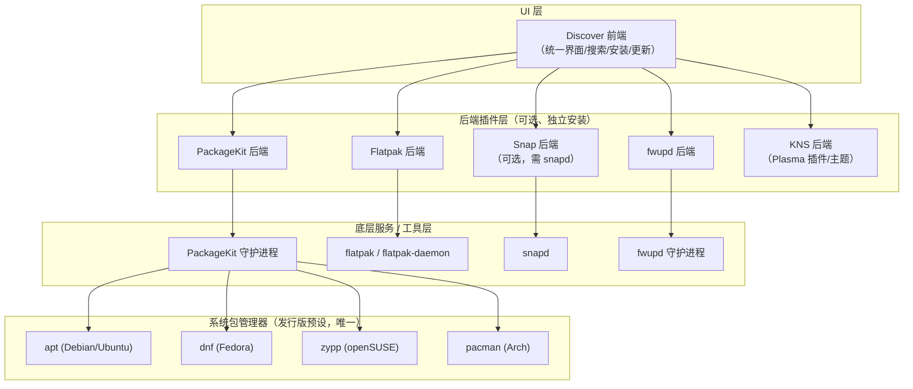

# {{ $frontmatter.title }}

在 Linux 中，你看到的界面是由桌面环境搭建的，没有桌面环境，Linux 就只有命令行，也就是服务器版本了。Linux 完全可以脱离图形界面，当作个人电脑使用时，桌面环境大大提升了使用体验。

不建议在当前系统使用原装桌面环境以外的桌面环境。理论上可以这么做，在一个系统内同时安装多个桌面环境，每次登入时选择想使用的桌面环境，不过：
1. 那些非原装的桌面环境一是功能不一定完善
2. 可能与系统其他组件冲突
3. 每个桌面环境都有自己的一套工具，会混杂在其他桌面环境中，使用体验不佳。

例如，你安装的是 Linux Mint Cinnamon，原装桌面环境就是 Cinnamon，如果在这个系统里面使用 KDE，会发现功能不够完善。再以 Cinnamon 桌面环境登入系统，会发现混杂了 KDE 带有的一些软件如 Kate。想体验 KDE 就去安装原装桌面环境是 KDE 的系统，如 KUbuntu。

获取当前桌面环境：
```
$ echo $DESKTOP_SESSION
```

## GNOME
不推荐。Ubuntu 上面的 GNOME 还好，其他发行版的就很难用了。桌面上只有背景，什么都放不了，还要下插件才能解决。每次按 Super（Win）键才能切换应用，还要找半天，插件要么装不上，要么装上了功能也不完善。

## KDE
https://kde.org/zh-cn/

推荐。用爱发电，工作也很有成效！提供的壁纸和界面都很漂亮！

**推荐系统：** [KUbuntu](https://kubuntu.org/)。只是 ESP 需要 300M 以上，我安装不了。扩容的话，怕破坏 Windows 的引导项。

### KDE 独有软件管理工具 Discover
Discover 本身是一个**前端 UI 外壳**，它不直接与任何包管理器交互，而是通过**多个独立的后端插件**来统一管理不同类型的软件源。每个后端负责对接一种特定的软件分发机制。

核心逻辑分三层：

1. **UI 层（Discover 前端）**
   负责展示合并后的应用列表、搜索、安装/更新按钮。它把来自不同后端的结果聚合到一个界面里。

2. **后端插件层（Backends）**
   每个后端是一个独立插件，各自对接一种软件源：
   - **PackageKit 后端**：对接系统包管理器（通过 PackageKit 抽象层）。
   - **Flatpak 后端**：对接 Flatpak。
   - **Snap 后端**：对接 Snap（可选，需单独安装且依赖 `snapd`）。
   - **fwupd 后端**：对接固件更新。
   - **KNS 后端**：对接 KDE 商店的 Plasma 插件/主题。

3. **底层服务/工具层**
   - PackageKit 再往下调用发行版预设的**唯一**系统包管理器（apt/dnf/zypp/pacman 等）。
   - Flatpak 调用 `flatpak` 命令与 `flatpak-daemon`。
   - Snap 调用 `snapd`。
   - fwupd 调用 `fwupd` 守护进程。

**关键点**：Discover 的“多源统一管理”能力，来自于它在 UI 层同时集成了多个后端；而 `pkcon` 这类命令行工具只对应 PackageKit 一个后端，无法覆盖 Flatpak/Snap。



补充说明
- 图中 `PKS` 指向四个包管理器，表示 PackageKit **只会根据发行版配置激活其中一个**，并非同时调用。
- `Snap 后端` 用虚线语义表示“可选”：未安装该插件或未安装 `snapd` 时，Discover 不会管理 Snap，界面中也不会出现 Snap 来源。
- `KNS 后端` 不涉及系统包管理器，直接对接 KDE 的在线商店服务。


## Cinnamon
推荐。超级好用！是 Linux Mint 的默认桌面环境，也是这个团队开发的。

**推荐系统：** 当然是 Linux Mint Cinnamon


## MATE
还行吧，功能上不如 Cinnamon，比 Cinnamon 轻量。

**推荐系统：** Linux Mint MATE

## XFCE
轻量。

**推荐系统：** Linux Mint Xfce

## LxQt
轻量。

**推荐系统：** LUbuntu