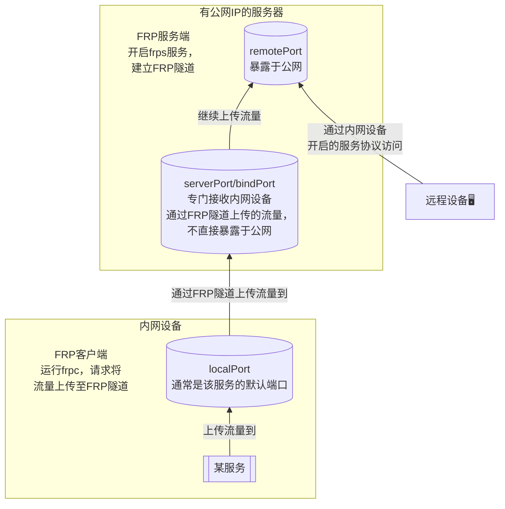
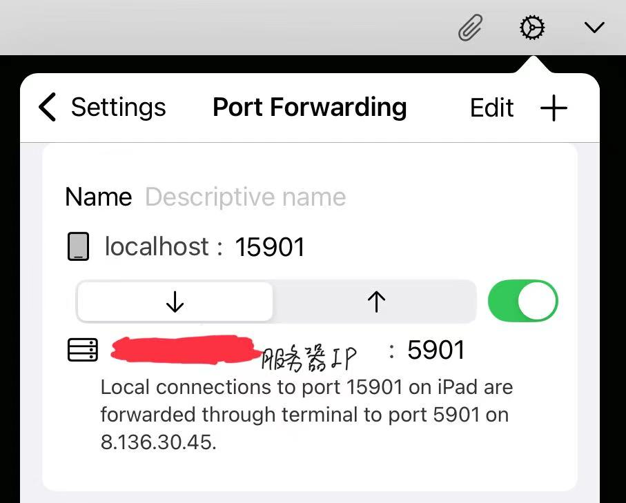

FRP
---

一种内网穿透的方法。

# 背景
我唯一的一台电脑放在家里。有时我着急出门，但此时电脑可能在运行耗时较长的任务，运行完了我还要操控电脑，于是把更便携的 iPad 带出门，希望通过 ShellFish 或 RVNC Viewer 这样的 App 连接电脑，达到远程控制的目的。电脑连接的WLAN在运营商下，公网IP会实时变化，且端口受到运营商限制，所以不能直接通过电脑的公网IP来连接。我了解到可以通过内网穿透来解决。

# 内网穿透与FRP {#内网穿透与FRP}
**内网穿透**，是将本地端口映射到公网端口，实现从公网访问本地服务的目的。原理是：
```text
远程设备  →  主动连接中转服务器  ←  内网设备
			   （有公网IP）
```
有公网IP的中转服务器？正好我有一台安装了Rocky Linux的云服务器，有固定的公网IP，能通过各种协议顺利连接。而 iPad 就是远程设备，家里的电脑是内网设备。

**内网穿透的常用工具有 frp、ngrok、Tailscale 等**，其中 Tailscale 最简单，不需要自己搭服务器，但需要注册账号，我不太喜欢。所以这里选择 FRP。

FRP 基于 Go 语言，在本案例中是这样的流程：

出门前，先在云服务器上启动 `frps` 服务，然后在电脑上启动 `frpc`。在外面，用 iPad 通过 RealVNC Viewer 或 ShellFish 连接云服务器的 `remotePort` 端口，即可访问家里的电脑。此时在FRP的范畴内，云服务器是服务端，电脑是客户端；在“某服务”的范畴内，电脑是服务端，iPad是客户端。

# 配置步骤
https://zhuanlan.zhihu.com/p/1913504354721333378
这篇文章是保姆级别，但在配置文件中以明文（token）的形式设置密码，存在安全问题，于是我另写了一套步骤。

## 下载 FRP 项目
在服务端和客户端上均执行：
```bash
wget https://github.com/fatedier/frp/releases/download/v0.68.0/frp_0.68.0_linux_amd64.tar.gz
tar -xvf frp_0.68.0_linux_amd64.tar.gz
cd frp_0.68.0_linux_amd64

$ ls
frpc  frpc.ini  frps  frps.ini  LICENSE
```

## 生成密钥对——TLS 证书认证
完全摒弃 token，使用证书认证，更安全且无需共享密码。
### 创建生成密钥对的配置文件
```ini
# ca.cnf
[req]
distinguished_name = my_distinguished_name
prompt = no

[my_distinguished_name]
C = CN
O = HuihuiHan 
CN = MyCA
```

```ini
# server.cnf
[req]
distinguished_name = my_distinguished_name
prompt = no

[my_distinguished_name]
C = CN
O = AliCloud
OU = RockyServer
CN = <服务器IP>

[v3_req]
subjectAltName = @alt_names

[alt_names]
IP.1 = <服务器IP>
```

```ini
# client.cnf
[req]
distinguished_name = my_distinguished_name
prompt = no

[my_distinguished_name]
C = CN
O = HuihuiHan 
CN = MyMint
```
- 配置文件语法介绍
	采用 `.ini`文件的形式。
	- 用方括号表示session，例如`req`就是一个session。
	- 用等号表示键值对，例如`distinguished_name = my_distinguished_name`中，`distinguished_name`是键，`my_distinguished_name`是值。
- **TLS内建字段，不能改名**
	- **`req`**：必须是配置文件的第一个session。
		- **`distinguished_name`(DN)**：填写国家（C，两个字母组成）、省份/州（ST）、城市（L）、组织（O）、部门（OU）、通用名称（CN）的信息。服务端的CN必须是IP地址或主机名。
		- **`prompt`**：是否提示用户输入信息，默认为`yes`。`prompt = no`配合`distinguished_name`，表示不提示，自动填入DN中指定的值。
	- **`subjectAltName`**：指定证书的替代名称，简称**SAN**，是现代 TLS 校验的核心。现在的浏览器和 Go 语言（FRP 的底层语言）已经基本废弃了对 CN 的校验，转而强制要求 SAN。**服务端必须设置SAN**，而CA和客户端可以不设置。
		- `IP.1`：第一个IP地址形式的替代名称，还可以是`IP.2`、`IP.3`等。域名形式的替代名称，例如`DNS.1`、`DNS.2`等。
- 为自定义名称的字段
	`my_distinguished_name`、`v3_req`、`alt_names`。
	
### 生成私钥和证书
```bash
#!/usr/bin/env bash
# keycrtgen.sh 
# 生成密钥对——TLS 证书认证
# 生成的文件名为 ca.xxx（CA），server.xxx（服务端），client.xxx（客户端）

keylen=2048
validdays=3650

# 生成CA私钥
openssl genrsa -out ca.key $keylen
# CA自签名证书
openssl req -x509 -new -nodes -key ca.key -days $validdays -out ca.crt -config ca.cnf

# 生成服务端私钥
openssl genrsa -out server.key $keylen
# 生成服务端证书签名请求（CSR）
openssl req -new -key server.key -out server.csr -config server.cnf
# 向 CA 出示签名请求，生成服务端证书。需要CA证书和私钥。
openssl x509 -req -in server.csr -CA ca.crt -CAkey ca.key -CAcreateserial -out server.crt -days $validdays -extfile server.cnf -extensions v3_req

# 生成客户端私钥
openssl genrsa -out client.key $keylen
# 生成客户端证书签名请求（CSR）
openssl req -new -key client.key -out client.csr -config client.cnf
# 向 CA 出示签名请求，生成客户端证书。需要CA证书和私钥。
openssl x509 -req -in client.csr -CA ca.crt -CAkey ca.key -CAcreateserial -out client.crt -days $validdays -extfile client.cnf
```
- **`openssl genrsa`**：生成基于RSA算法的私钥。
- **`openssl req`**：生成证书签名请求（CSR）。
	- `-x509`：直接生成自签名证书。
- **`openssl x509 -req`**：处理证书签名请求（CSR），由CA签名，生成证书。
	- `-days`：证书有效期。
	- `-extfile`：指定证书的扩展所在的文件。SAN 就是证书扩展的一种。
	- `-extensions`：指定扩展在扩展文件中所在的session。有人问


```bash
#!/usr/bin/env bash
# check.sh
# 检查 keycrtgen.sh 生成的文件是否存在，server.crt（服务端证书） 是否包含 SAN

for filename in ca.key ca.srl ca.crt server.key server.csr server.crt client.key client.csr client.crt; do
	if [ -f $filename ]; then
		echo "✅ $filename 存在"
	else
		echo "❌ $filename 不存在"
	fi
done

if [ -n "$( openssl x509 -text -noout -in server.crt | grep -A 1 'Subject Alternative Name' )" ]; then
	echo "✅ 服务端证书 server.crt 包含 SAN"
else
	echo "❌ 服务端证书 server.crt 不含 SAN"
fi
```
```bash
#!/usr/bin/env bash
# clean.sh
# 删除 keycrtgen.sh 生成的文件
rm ca.crt  ca.key  ca.srl  client.crt  client.csr  client.key  server.crt  server.csr  server.key
```
### 整理私钥和证书文件
```bash
$ ls
ca.cnf  ca.crt  ca.key  ca.srl  clean.sh  client.cnf  client.crt  client.csr  client.key  keycrtgen.sh  server.cnf  server.crt  server.csr  server.key
```
将`ca.key`、`ca.srl`离线存储，如 U 盘上。不要存储在任何联网设备，如你的电脑。不使用 CA 签名新的证书时，不要暴露在任何网络上。`ca.srl`用于记录 CA 签名的证书序列号，防止重复签名。
将`server.crt`、`server.key`、`ca.crt`上传到服务端，`client.crt`、`client.key`、`ca.crt`保存到客户端。
`.cnf`和`.csr`文件是生成证书的辅助文件，删除后不影响 frp 的运行。

## 服务端和客户端的 FRP配置文件
```ini
# 服务端上的 frps.ini
bindPort = 7000

transport.tls.force = true
transport.tls.certFile = "./ssl/server.crt"
transport.tls.keyFile = "./ssl/server.key"
transport.tls.trustedCaFile = "./ssl/ca.crt"
```

```ini
# 客户端上的 frpc.ini
serverAddr = "<服务器IP>"                  
serverPort = 7000                           
											
transport.tls.enable = true                 
transport.tls.certFile = "./ssl/client.crt" 
transport.tls.keyFile = "./ssl/client.key"  
transport.tls.trustedCaFile = "./ssl/ca.crt"
											
[[proxies]]                                 
name = "ssh"                                
type = "tcp"                                
localIP = "127.0.0.1"                       
localPort = 22                              
remotePort = 6000    

[[proxies]]
name = "vnc"
type = "tcp"
localIP = "127.0.0.1"
localPort = 5901
remotePort = 5901
```
这两份配置文件的各种 Port 与前面画的[FRP原理图](#内网穿透与FRP)一一对应；提到的路径是相对于配置文件本身的，也可以是绝对路径。

# 测试步骤
## SSH
```bash
# 服务端，要指定配置文件路径
./frps -c frps.ini
# 客户端，要指定配置文件路径
systemctl start sshd	# 启动SSH服务
./frpc -c frpc.ini
```
在远程设备上，用SSH连接服务端的6000端口（`remotePort`值）即可。

如果`frps`启动成功且正常运行，但客户端`frpc`连不上，常见的一个坑是云服务器的防火墙没有打开 6000 或 7000 端口。启动成功仅代表程序占用了端口，并不代表流量能穿过这个端口（**网络链路阻断**）。

在`frps`启动的情况下，先看端口是不是真的被阻断了：
```bash
nc -zv <服务器公网IP> 6000
nc -zv <服务器公网IP> 7000
```
只有有 succeeded 字眼时才表示端口是开放的，否则就是被阻断了。

发现是被阻断了。网络链路阻断的常见原因有两个：
1. **服务器系统本地的防火墙**
	```bash
	# 在服务端执行
	# 检查 7000 端口是否在放行列表
	sudo firewall-cmd --list-ports

	# 如果没有，手动添加（frps 绑定的 bindPort）
	sudo firewall-cmd --permanent --add-port=7000/tcp
	# 同时顺便放行你的远程访问端口（remotePort）
	sudo firewall-cmd --permanent --add-port=6000/tcp
	# 重载配置生效
	sudo firewall-cmd --reload
	```
	不过我没设过本地防火墙唉，执行第一 行就提示 FirewallD is not running。在这种情况下，本地端口默认是完全敞开的。
2. **云平台的外层安全组策略**
	登录云服务器的网页控制台，设置安全组，放行 7000 端口和 6000 端口，类似于下图：
	

## VNC
服务端：
```
frps -c frps.ini
```
客户端：
```bash
# 安装 VNC 服务器 x11vnc
sudo apt install x11vnc
# 首次设置密码
x11vnc -storepasswd ~/.vnc/x11vnc.passwd
# 启动（共享物理屏幕）
x11vnc -display :0 -rfbport 5901 -rfbauth ~/.vnc/x11vnc.passwd -ncache 0

# 创建FRP隧道
./frpc -c frpc.ini
```
远程设备上：
```bash
ssh -L 15901:localhost:5901 -p 6000 服务器IP
```
15901 是远程设备的，5901 是服务器的，localhost是相对服务器而言的。效果是将服务器的5901端口映射到远程设备的15901端口。
不过 iPad 没有命令行支持上面的命令，以 ShellFish 这个 App 为例，`-L 15901:localhost:5901` 需要在连接好服务器后的界面上，点击右上角的设置图标进行如下设置来实现：


最后去远程设备上，用 VNC 连接 `localhost:15901` 即可。


# 写成服务
测试成功后，如果以后经常用到的话，建议写成服务。

将`frps`和`frpc`移动到 `/usr/bin` 目录下，将`LICENSE`、`.ini`文件、证书和密钥移动到 `/etc/frp` 目录下，结构如下（以客户端为例，服务端同理）：
```bash
$ sudo tree /etc/frp/    
/etc/frp/
├── frpc.ini
├── LICENSE
└── ssl
    ├── ca.crt
    ├── client.crt
    └── client.key

2 directories, 5 files
```
## 系统级服务——frpsd, frpcd
有两个 `.service` 文件，在 `/etc/systemd/system` 目录下。
```ini
# frpsd.service
[Unit]
Description=FRP Server (frps)
After=network.target

[Service]
Type=simple
WorkingDirectory=/etc/frp
ExecStart=/usr/bin/frps -c /etc/frp/frps.ini
Restart=on-failure
RestartSec=5s

[Install]
WantedBy=multi-user.target
```

```ini
# frpcd.service
[Unit]
Description=FRP Client (frpc)
After=network.target

[Service]
Type=simple
WorkingDirectory=/etc/frp
ExecStart=/usr/bin/frpc -c /etc/frp/frpc.ini
Restart=on-failure
RestartSec=5s

[Install]
WantedBy=multi-user.target
```

## 用户级服务——x11vnc
在 `~/.config/systemd/user` 目录下。
```ini
# x11vncserver.service
[Unit]
Description=x11vnc VNC Server
After=graphical-session.target

[Service]
ExecStart=x11vnc -display :0 -rfbport 5901 -rfbauth %h/.vnc/x11vnc.passwd -ncache 0 -forever
Restart=on-failure
RestartSec=5s

[Install]
WantedBy=default.target
```

## 后续工作
写好服务文件后，在服务端和客户端均执行：
```bash
systemctl daemon-reload
```
执行系统级服务：
```bash
systemctl start <服务名>
```
执行用户级服务：
```bash
systemctl --user start <服务名>
```
