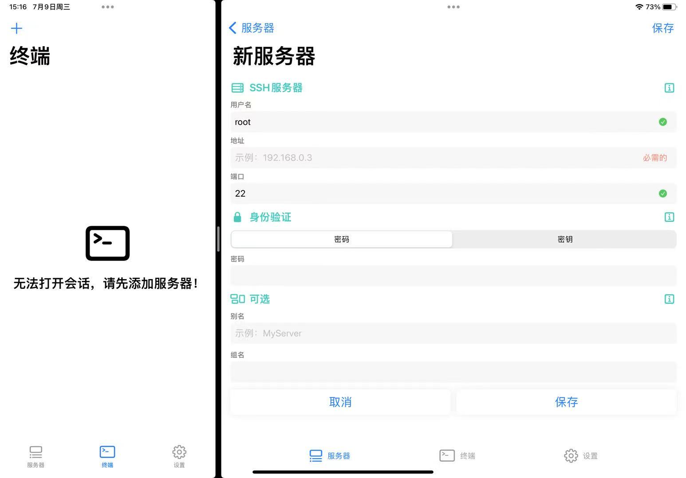

# {{ $frontmatter.title }}


安全外壳。

## 背景
韩会会正在上一节无聊的选修课，想学Linux，只看书不操作的效果肯定不好。教室里没有插座，带电脑的计划泡汤。我的 **Android手机（甲）** 上安装了 **Termux**，可以用来学习 Linux，但手机屏幕太小，长时间操作起来很不方便。于是我想从 **iPad（乙）** 上下手，再连接蓝牙键盘，操作起来的感觉和电脑相似，舒服多了。

为此，在乙上安装好终端软件，以 **Terminal** 为例。打开一看，立马傻眼：“无法打开会话，请先添加服务器！”什么用户名、地址、端口、密码……完全不清楚怎么填！😭



这是我第一次接触服务器相关的知识，于是记录这段经历，留作纪念🎉。我还尝试了iOS上其他的SSH终端软件，比如`SSH Term`、`xTerm256` 、`ShellFish`，都是我认为比较好用的。

## 🧩 开启 SSH 服务
1. 设置密码（首次登录需要）：
    ```bash
    passwd
    ```
    这个就是添加新服务器时需要的密码。
2. 默认 SSH 端口为：
    ```bash
    8022
    ```
    如果甲没有被root，这个端口就是取默认的8022，因为没root的设备没有权限修改。
3. 安装并启动 SSH 服务：
    ```bash
    pkg update && pkg install openssh
    sshd
    ```

## 📡 正确选取 IP 地址
### 查看所有接口
```bash
u0_a294@localhost:~$ ifconfig
Warning: cannot open /proc/net/dev (Permission denied). Limited output.
lo: flags=73<UP,LOOPBACK,RUNNING>  mtu 65536
        inet 127.0.0.1  netmask 255.0.0.0
        unspec 00-00-00-00-00-00-00-00-00-00-00-00-00-00-00-00  txqueuelen 1000  (UNSPEC)

rmnet_data2: flags=65<UP,RUNNING>  mtu 1400
        inet 10.201.xx.xx  netmask 255.255.255.248
        unspec 00-00-00-00-00-00-00-00-00-00-00-00-00-00-00-00  txqueuelen 1000  (UNSPEC)

wlan0: flags=4163<UP,BROADCAST,RUNNING,MULTICAST>  mtu 1500
        inet 10.20.xx.xx  netmask 255.252.0.0  broadcast 10.23.xx.255
        unspec 00-00-00-00-00-00-00-00-00-00-00-00-00-00-00-00  txqueuelen 3000  (UNSPEC)

wlan2: flags=4163<UP,BROADCAST,RUNNING,MULTICAST>  mtu 1500
        inet 192.168.xx.xx  netmask 255.255.255.0  broadcast 192.168.xx.255
        unspec 00-00-00-00-00-00-00-00-00-00-00-00-00-00-00-00  txqueuelen 3000  (UNSPEC)

u0_a294@localhost:~$
```
其中`inet`的内容是我们想要的。不过这么多`inet`，到底是哪个呢？

### ❓ 哪个才是正确 IP？
| 接口名  | 作用 | 用于 SSH |
| :----: | :--: | :------: |
| lo	|本地回环地址（localhost）	|❌|
| rmnet*	|蜂窝数据接口（流量）	|❌|
| wlan0	|本机 Wi-Fi 网卡（主接口）	|⚠️ 不稳定|
| wlan2 / ap0	| 个人热点虚拟接口	|✅ 最优解|

* **看哪个接口的 IP 是 `192.168.x.x` 且 broadcast 有值**
* 甲打开个人热点时，相当于一个迷你无线路由器，提供`wlan2`接口，供乙访问。
* 🧠 为什么乙看到的是 192.168.x.x 地址，而不是蜂窝数据的地址？这是因为甲在后台做了这些事：
    1. 分配一个内网网段（如 192.168.174.0/24）
    2. 给连接设备分配 IP（如 iPad 得到 192.168.174.xx）
    3. 启用 NAT，把 iPad 的数据转发到蜂窝网络 	

## 🧩 连接 SSH
### GUI（本例）
- 将乙连接甲的热点
- IP 地址：通过 Android 接口查看
- 端口：`8022`(默认值，没root的设备无法修改)
- 用户名：**Termux** 的用户名，在这里是u0_a294
- 密码：在甲上用`passwd`设置的密码

开心冲浪！😅
### 命令行模式（Linux丙设备的终端，欲连接甲的SSH服务）
```bash
ssh <用户名>@<主机IP地址> -p <端口号>
# 例如 ssh u0_a294@192.168.xxx.xxx -p 8022
```
注意，首次连接时需要回答完整的yes三个字母，直接按回车会连接失败的。
```bash
binzz@C7VF:~$ ssh u0_a294@192.168.xxx.xxx -p 8022
The authenticity of host '[192.168.xxx.xxx]:8022 ([192.168.xxx.xxx]:8022)' can't be established.
ED25519 key fingerprint is xxxxxxxxxxxxx.
This key is not known by any other names.
Are you sure you want to continue connecting (yes/no/[fingerprint])? <== 一定要输入完整的yes
Host key verification failed. <== 直接回车的结果
binzz@C7VF:~$ 
```
还需要输入甲的用户密码。第二次连接时，就不需要输入密码，因为第一次根据输入的密码更新了密钥文件 `~/.ssh/known_hosts`。下面的案例中，用另一张SD卡插入树莓派，再次连接树莓派时，发现如下错误，提示“doing something nasty”。从输出中看出，不仅有密钥文件，还有其旧的版本 `~/.ssh/known_hosts.old`。
```bash
binzz@C7VF:~$ ssh binzz@192.168.xx.xx
@@@@@@@@@@@@@@@@@@@@@@@@@@@@@@@@@@@@@@@@@@@@@@@@@@@@@@@@@@@
@    WARNING: REMOTE HOST IDENTIFICATION HAS CHANGED!     @
@@@@@@@@@@@@@@@@@@@@@@@@@@@@@@@@@@@@@@@@@@@@@@@@@@@@@@@@@@@
IT IS POSSIBLE THAT SOMEONE IS DOING SOMETHING NASTY!
Someone could be eavesdropping on you right now (man-in-the-middle attack)!
It is also possible that a host key has just been changed.
The fingerprint for the ED25519 key sent by the remote host is
SHA256:zdwcD7PwaIn8P4rZVzVJZA3xq96gLv1viRsLlElTomA.
Please contact your system administrator.
Add correct host key in /home/binzz/.ssh/known_hosts to get rid of this message.
Offending ECDSA key in /home/binzz/.ssh/known_hosts:3
  remove with:
  ssh-keygen -f '/home/binzz/.ssh/known_hosts' -R '192.168.xx.xx'
Host key for 192.168.xx.xx has changed and you have requested strict checking.
Host key verification failed.
binzz@C7VF:~$ ssh-keygen -f '/home/binzz/.ssh/known_hosts' -R '192.168.xx.xx'
# Host 192.168.xx.xx found: line 1
# Host 192.168.xx.xx found: line 2
# Host 192.168.xx.xx found: line 3
/home/binzz/.ssh/known_hosts updated.
Original contents retained as /home/binzz/.ssh/known_hosts.old
binzz@C7VF:~$
```

## SSH 密钥对实现安全的免密登录
密码容易被暴力破解，禁止密码登录、使用密钥对可以解决这个问题，且不需要手动输入密码。先生成密钥对，确认可以用密钥登录后，再禁止密码登录，以防被锁死。

SSH 密钥对由一个公钥和一个私钥组成，两者一一对应。公钥需要公开，私钥必须保密。

利用密钥对进行连接的一般方法如下。

### 客户端生成密钥对
```bash
binzz@C7VF:~$ ssh-keygen -t ed25519 -C my_email@example.com
Generating public/private ed25519 key pair.
Enter file in which to save the key (/home/binzz/.ssh/id_ed25519): 
/home/binzz/.ssh/id_ed25519 already exists.
Overwrite (y/n)? n
binzz@C7VF:~$ 
```

### 将客户端的公钥添加到服务端
```bash
binzz@C7VF:~$ ssh-copy-id -i .ssh/id_ed25519.pub -p 8022 admin@<serverIP>
/usr/bin/ssh-copy-id: INFO: Source of key(s) to be installed: ".ssh/id_ed25519.pub"
/usr/bin/ssh-copy-id: INFO: attempting to log in with the new key(s), to filter out any that are already installed
/usr/bin/ssh-copy-id: INFO: 1 key(s) remain to be installed -- if you are prompted now it is to install the new keys
admin@<serverIP>'s password: 

Number of key(s) added: 1

Now try logging into the machine, with:   "ssh 'admin@<serverIP>'"
and check to make sure that only the key(s) you wanted were added.

binzz@C7VF:~$ 
```
### 登录，不需要输入密码
```bash
ssh admin@<serverIP>
```
### 禁止密码和Root登录
在服务端上
```bash
vim /etc/ssh/sshd_config

# 如果服务端是 Android 设备上的 Termux，应如下做：
# vim $PERFIX/etc/ssh/sshd_config
```
进行如下设置：
```bash
PermitRootLogin no
PasswordAuthentication no
```
然后重启 SSH 服务：
```bash
systemctl restart sshd

# 如果服务端是 Android 设备上的 Termux，应如下做：
# killall sshd
# pkill sshd
# sshd
```

## `~/.ssh/config` 文件
通过它，可以为不同的远程主机预设登录别名、IP 地址、端口、用户名和私钥路径，从而把复杂的 `ssh <user>@<host> -p <port> -i <key>` 简化为一条简单的 `ssh <alias>` 命令。

* 权限要求：为了安全，该文件的权限必须设为 600（仅所有者可读写），否则 SSH 会报错拒绝读取。

文件内容示例：
```bash
# 简易服务器配置
Host myserver
    HostName 192.168.1.100
    User root
    Port 22

# 使用指定密钥的服务器
Host dev-env
    HostName 10.0.0.50
    User ubuntu
    IdentityFile ~/.ssh/id_rsa_dev

# 使用通配符（对所有主机生效的通用配置）
Host *
    ServerAliveInterval 60
    AddKeysToAgent yes
```

* Host：自定义的别名，输入 ssh <Host> 即可触发对应配置。
* HostName：真实的远程服务器 IP 地址或域名。
* User：登录远程服务器的用户名。
* Port：SSH 端口（默认是 22）。
* IdentityFile：该主机专属的私钥文件路径。
* ServerAliveInterval：每隔多少秒向服务器发送一次心跳包，防止连接超时断开。 
