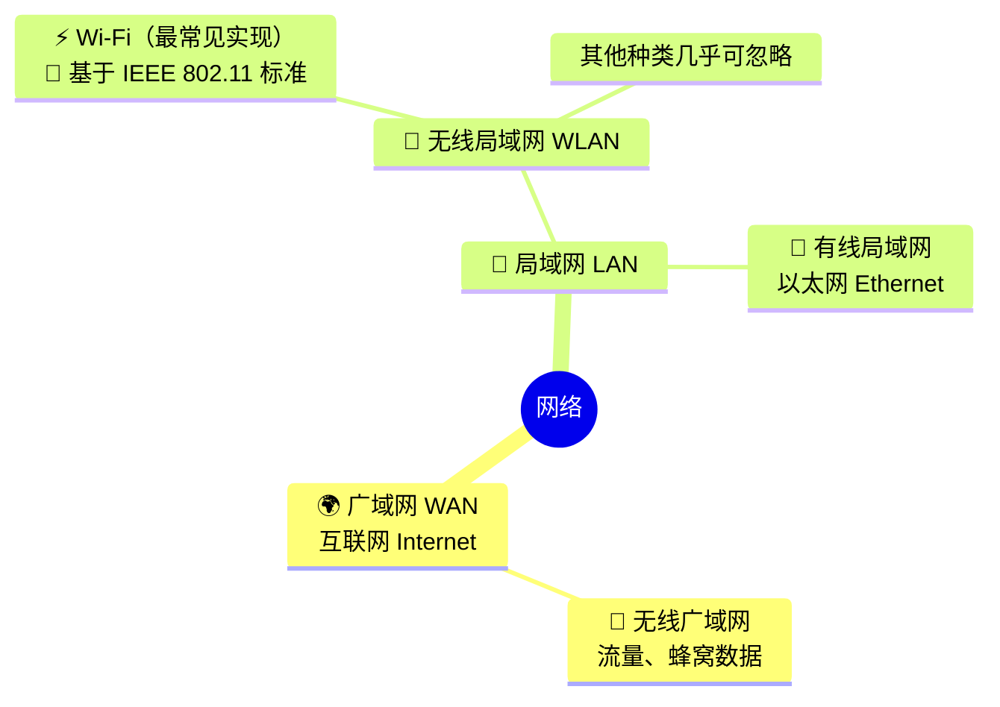
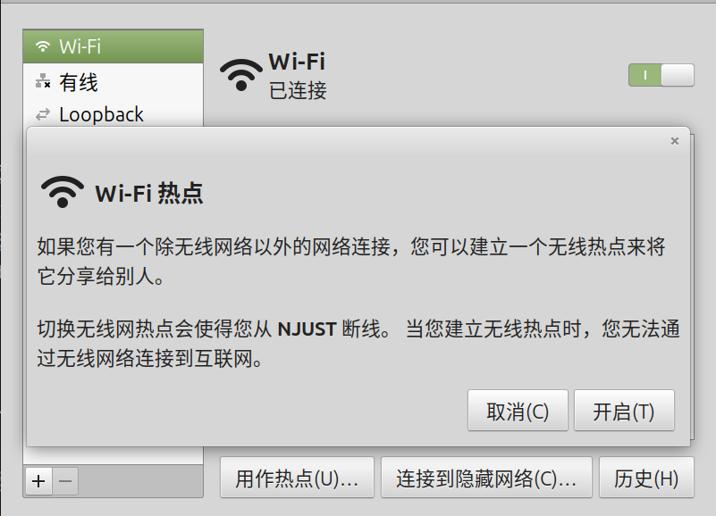
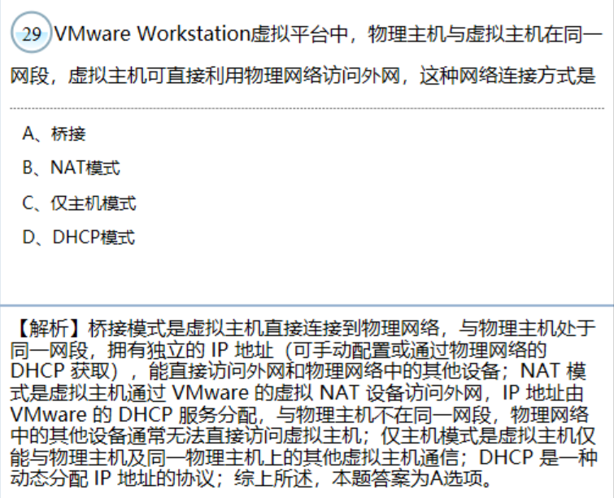

# {{ $frontmatter.title }}

**Q**：作为日常生活的常用语，“没连网”的“网”指什么？智能手机的设置或控制中心上有📶🛜的图标，分别是什么意思？理清无线局域网、WiFi、WLAN、WAN、LAN 的概念。同样都可以通过手机打开，设置特定的网络名，供其他设备连接，个人热点和无线中继之间有什么区别？
**A**：

“没连网”的“网”指 WLAN，即无线局域网。🛜代表WLAN；📶代表无线广域网，也就是我们常说的蜂窝数据或移动网络，是要通过SIM卡（手机卡、电话卡）上消耗流量的，给运营商支付一定的费用。电脑没有SIM卡，连接无线网络时只有🛜而没有📶的选项。大家经常混淆 WLAN 和 WiFi 的概念，是因为其他类型的 WLAN 要么被淘汰，要么用在特定场合，而这个特定场合有自己的标准，极其不通用，所以这个特定场合往往涉密，WLAN约等于WiFi。

手机的**个人热点**指，手机利用蜂窝数据**创建**一个小范围的WLAN供其他设备使用，需要消耗流量。电脑也可以创建个人热点，不过就不一定是这种消耗流量的方式了。

这涉及单网卡限制。大部分普通电脑的无线网卡，要么作为「客户端」连接外部 Wi‑Fi（比如你现在连的 NJUST），要么作为「AP 热点」供其他设备连接，**不能同时做两件事**。所以开启热点时，必须先断开当前的 Wi‑Fi 连接，改用**有线网/其他非 Wi‑Fi 网络**作为上网来源。

**无线中继**指，设备**放大**自身已连接的WLAN的覆盖范围，是否消耗流量取决于那个WLAN的来源。如果手机没有连WLAN，而是连的蜂窝数据，那么该手机不能开启无线中继。

如果周围没有 WLAN,一台设备不能连接蜂窝网络，且不想连接有线网络，你的手机就应该开启个人热点，创造出一个WLAN，供那台设备使用，此时你的手机相当于一台路由器。如果一台设备连接到的WLAN的信号很弱，你可以把手机放在该WLAN信号较强的范围内，连接该WLAN，开启无线中继模式，这样把该WLAN的信号放大后再广播出去，该设备的WLAN信号就变强了。


## IP地址
### 子网掩码
子网掩码（Subnet Mask）是用于将IP地址分为网络号和主机的二进制数。它通过将IP地址的二进制表示中，将网络号和主机号的位数设置为1和0，来实现。
#### CIDR表示法
`192.168.1.10/24` 里的 `/24` 是**子网掩码的CIDR（无类别域间路由）表示法**，它代表了子网掩码的二进制位数。
- `/24` 表示：**前24位是网络位，后8位是主机位**
- 对应的子网掩码是：`255.255.255.0`
- 换算成二进制：
  ```
  11111111.11111111.11111111.00000000
  ↑          24个1           ↑  8个0
  ```
常见CIDR对照：
| CIDR | 子网掩码 | 可用主机数 |
|------|----------|------------|
| /24  | 255.255.255.0 | $2^8-2=254$ |
| /16  | 255.255.0.0 | $2^16-2=65534$ |
| /8   | 255.0.0.0 | $2^24-2=16777214$ |

为什么少两个主机地址？因为每个子网都有一个：
- 广播地址（Broadcast Address），主机号每位均为1的地址
- 网络地址（Network Address），主机号每位均为0的地址

这两个地址都不能用来作为主机地址。

### 查看IP地址
```bash
$ ifconfig
enp3s0: flags=4099<UP,BROADCAST,MULTICAST>  mtu 1500
        ether d8:xx:xx:xx:xx:c4  txqueuelen 1000  (以太网)
        RX packets 0  bytes 0 (0.0 B)
        RX errors 0  dropped 0  overruns 0  frame 0
        TX packets 0  bytes 0 (0.0 B)
        TX errors 0  dropped 0 overruns 0  carrier 0  collisions 0

lo: flags=73<UP,LOOPBACK,RUNNING>  mtu 65536
        inet 127.0.0.1  netmask 255.0.0.0
        inet6 ::1  prefixlen 128  scopeid 0x10<host>
        loop  txqueuelen 1000  (本地环回)
        RX packets 513144  bytes 627814341 (627.8 MB)
        RX errors 0  dropped 0  overruns 0  frame 0
        TX packets 513144  bytes 627814341 (627.8 MB)
        TX errors 0  dropped 0 overruns 0  carrier 0  collisions 0

wlp4s0: flags=4163<UP,BROADCAST,RUNNING,MULTICAST>  mtu 1500
        inet 10.20.xx.xx  netmask 255.252.0.0  broadcast 10.23.255.255
        inet6 2001:xx:xx:xx::4f9  prefixlen 128  scopeid 0x0<global>
        inet6 fe80::xxxx:xxxx:xxxx:25a5  prefixlen 64  scopeid 0x20<link>
        ether fe80::xxxx:xxxx:xxxx:25a5  txqueuelen 1000  (以太网)
        RX packets 843391  bytes 651396800 (651.3 MB)
        RX errors 0  dropped 0  overruns 0  frame 0
        TX packets 759354  bytes 202682318 (202.6 MB)
        TX errors 0  dropped 0 overruns 0  carrier 0  collisions 0

$ ip addr show
1: lo: <LOOPBACK,UP,LOWER_UP> mtu 65536 qdisc noqueue state UNKNOWN group default qlen 1000
    link/loopback 00:00:00:00:00:00 brd 00:00:00:00:00:00
    inet 127.0.0.1/8 scope host lo
       valid_lft forever preferred_lft forever
    inet6 ::1/128 scope host noprefixroute 
       valid_lft forever preferred_lft forever
2: enp3s0: <NO-CARRIER,BROADCAST,MULTICAST,UP> mtu 1500 qdisc fq_codel state DOWN group default qlen 1000
    link/ether d8:xx:xx:xx:xx:c4 brd ff:ff:ff:ff:ff:ff
3: wlp4s0: <BROADCAST,MULTICAST,UP,LOWER_UP> mtu 1500 qdisc noqueue state UP group default qlen 1000
    link/ether fe80::xxxx:xxxx:xxxx:25a5 brd ff:ff:ff:ff:ff:ff
    inet 10.20.xx.xx/14 brd 10.23.255.255 scope global dynamic noprefixroute wlp4s0
       valid_lft 193sec preferred_lft 193sec
    inet6 2001:xx:xx:xx::4f9/128 scope global dynamic noprefixroute 
       valid_lft 234sec preferred_lft 234sec
    inet6 fe80::xxxx:xxxx:xxxx:25a5/64 scope link noprefixroute 
       valid_lft forever preferred_lft forever

# 查看当前设备的公网IP
$ curl cip.cc
IP	: <IP>
地址	: 中国 江苏 南京
运营商	: 电信

数据二	: 中国江苏南京 | 电信

数据三	: 中国江苏省南京市 | 电信

URL	: http://www.cip.cc/<IP>
$ 
```


## 虚拟主机的网络连接方式

### 物理网络
简单来说，**物理网络**就是由真实的硬件设备（网线、交换机、路由器、网卡等）组成的实体网络，是数据传输的物理载体。
- 比如你家里的路由器、电脑、手机通过网线/Wi-Fi连接起来，就构成了一个小型物理网络；
- 虚拟机的“桥接模式”，就是让虚拟机像一台真实物理机一样，直接接入这个物理网络。

### 网段
**网段（Network Segment）** 是指在同一个IP地址范围内、可以直接互相通信的一组设备集合，由**IP地址 + 子网掩码**共同决定。
- 比如：`192.168.1.10/24` 和 `192.168.1.20/24` 属于同一网段（`192.168.1.0`），可以直接通信；
- 而 `192.168.1.10/24` 和 `192.168.2.10/24` 属于不同网段，需要通过路由器才能通信。
- 题目中“物理主机与虚拟主机在同一网段”，说明它们的IP地址在同一个范围内，能像局域网内两台真实电脑一样直接交互。

### 外网
**外网（公网/互联网）** 是指连接全球计算机的大型网络，也就是我们常说的“上网”的网络。
- 与外网相对的是**内网（局域网）**，比如家里的路由器、公司的办公网络都属于内网；
- 内网设备需要通过路由器/网关，才能访问外网（比如浏览网页、下载文件）；
- 题目中“访问外网”，就是指虚拟机可以连接到互联网，和我们日常用电脑上网是一个意思。

### 内网穿透
详情见 [FRP.md](FRP.md#内网穿透与frp)。