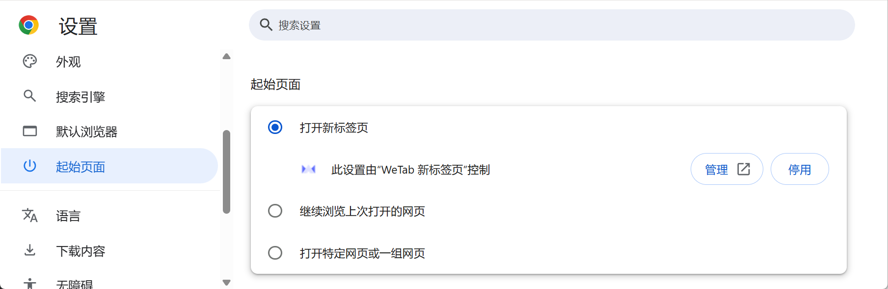
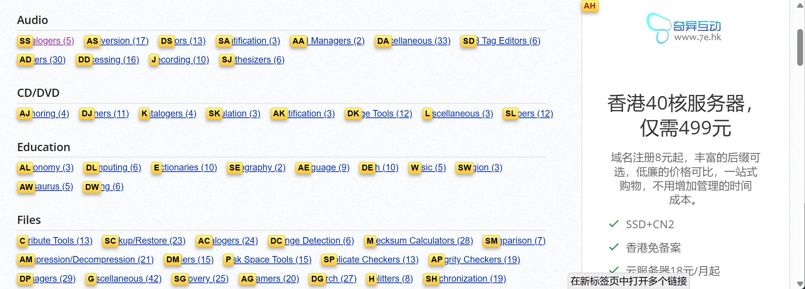

# {{ $frontmatter.title }}

[下载页](https://www.google.com/chrome/)

**Description：** {{ $frontmatter.description }}。

| 适用系统 | 类型 | 标签 |
| --- | --- | --- |
| {{ $frontmatter.os.join(', ') }} | {{ $frontmatter.category.join(', ') }} | {{ $frontmatter.tags.join(', ') }}

## 推荐扩展
### WeTab
自定义标签页。在浏览器的 “设置 -> 起始页面”中使 WeTab 生效。

### Vimium C
利用 vim 的逻辑，实现无鼠标使用网页。最高频的用法为，按下 F 键，网页上所有可点击的元素都会出现一个按键标签，输入标签提示的按键，即可点击该元素，如下图所示。

### 网页笔记插件
#### ✏️ 网页原生批注
笔记留在网页上，刷新页面还在。
1. **Web Highlights**（强烈推荐）
    - 功能：网页+PDF高亮、给划线文字附加笔记、多色标记、标签管理、AI摘要，支持导出 Markdown，可云端同步
    - 适合：学生阅读文献、长期网页资料整理
    - 优点：免费基础功能够用，不用注册也能本地使用
2. **Hypothesis**（开源学术批注）
    - 功能：网页/PDF标注、写评论、支持**多人协作批注**
    - 适合：论文研读、小组共同阅读资料
3. **Super Simple Highlighter** 极简高亮工具
    - 功能：纯高亮+附加备注，本地存储、开源无广告、快捷键操作
    - 适合：追求轻量化，不想复杂功能
4. **Floating Web Notes** 悬浮便签

    - 功能：给整个网站/单个页面绑定悬浮便签，独立文本笔记，不是文本划线，适合写页面备忘清单
5. **PageMark Annotator** 手绘标注

    - 功能：画笔、箭头、文本框，自由涂鸦标注网页，整页导出图片/PDF
    - 适合：截图反馈、网页做手绘批注

#### 📚 剪藏同步
网页内容保存到笔记软件。
1. **印象笔记 · 剪藏**
    - 一键保存网页正文、截图批注，同步到印象笔记，国内访问稳定
2. **Notion Web Clipper**
    - 网页直接存入 Notion 知识库，保留格式，可附加笔记
3. **Obsidian Web Clipper**
    - 导出 Markdown 到本地 Obsidian 库，适合本地双链笔记用户

#### 🧩 轻量备选
- Quick Notes Sidebar：侧边全局记事本，可区分「全站笔记 / 单页面笔记」
- Annotate Website：侧边面板统一管理全部批注，支持导出 Markdown、HTML

#### 📋 简单选型建议
- 读书、文献划线批注：**Web Highlights**
- 学术协作标注：**Hypothesis**
- 随手写页面备忘、清单：**Floating Web Notes**
- 手绘圈画、导出长截图：**PageMark Annotator**
- 习惯用印象/Notion/Obsidian：直接对应官方剪藏插件
