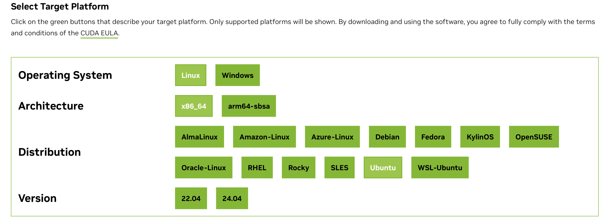

# {{ $frontmatter.title }}

**Description：** {{ $frontmatter.description }}。

| 适用系统 | 类型 | 标签 |
| --- | --- | --- |
| {{ $frontmatter.os.join(', ') }} | {{ $frontmatter.category.join(', ') }} | {{ $frontmatter.tags.join(', ') }}

---


[安装参考](https://blog.csdn.net/Sihang_Xie/article/details/127347139)

如果你的显卡是NVIDIA的，那么安装 NVIDIA CUDA Toolkit，则可以在编程、运行算法中发挥 GPU 的性能，提高运行速度。

首先你要[安装合适版本的 NVIDIA Dirver](NVIDIA_Driver.md)，`nvidia-smi` 的输出的 `CUDA Version` 值是可以安装的 CUDA 的最高版本。输出示例如下：

```
binzz@C7VF:~$ nvidia-smi
Mon Nov  2 15:58:21 2026 
+-----------------------------------------------------------------------------------------+
| NVIDIA-SMI 595.99.02              Driver Version: 595.99.02      CUDA Version: 13.2     |
+-----------------------------------------+------------------------+----------------------+
| GPU  Name                 Persistence-M | Bus-Id          Disp.A | Volatile Uncorr. ECC |
| Fan  Temp   Perf          Pwr:Usage/Cap |           Memory-Usage | GPU-Util  Compute M. |
|                                         |                        |               MIG M. |
|=========================================+========================+======================|
|   0  NVIDIA GeForce RTX 4060 ...    Off |   00000000:01:00.0 Off |                  N/A |
| N/A   43C    P0             15W /  140W |       2MiB /   8188MiB |      0%      Default |
|                                         |                        |                  N/A |
+-----------------------------------------+------------------------+----------------------+

+-----------------------------------------------------------------------------------------+
| Processes:                                                                              |
|  GPU   GI   CI              PID   Type   Process name                        GPU Memory |
|        ID   ID                                                               Usage      |
|=========================================================================================|
|  No running processes found                                                             |
+-----------------------------------------------------------------------------------------+
binzz@C7VF:~$
```

最高安装 13.2 版本，去[官方下载页](https://developer.nvidia.com/cuda-toolkit-archive)查询到，有好几个13.2.x，可以安装的最高版本其实是 13.2.xm（xm是下载页显示的x的最大值）。

点进可以安装的最高版本13.2.2，发现可以选择的 Ubuntu 系统只有 22.04 和 24.04这两个版本（如下图所示），而我的系统是 Ubuntu 26.04，也就是说，我的系统不在可以选择的系统版本之内，怎么办呢？



选择最接近的版本（我这里是24.04），出现了 Installer Type 选项，其中只有 `runfile(local)` 是与 Ubuntu 版本无关的，所以选择`runfile(local)`就可以了，然后按照选择后提供的安装方法安装 CUDA 就可以了！

