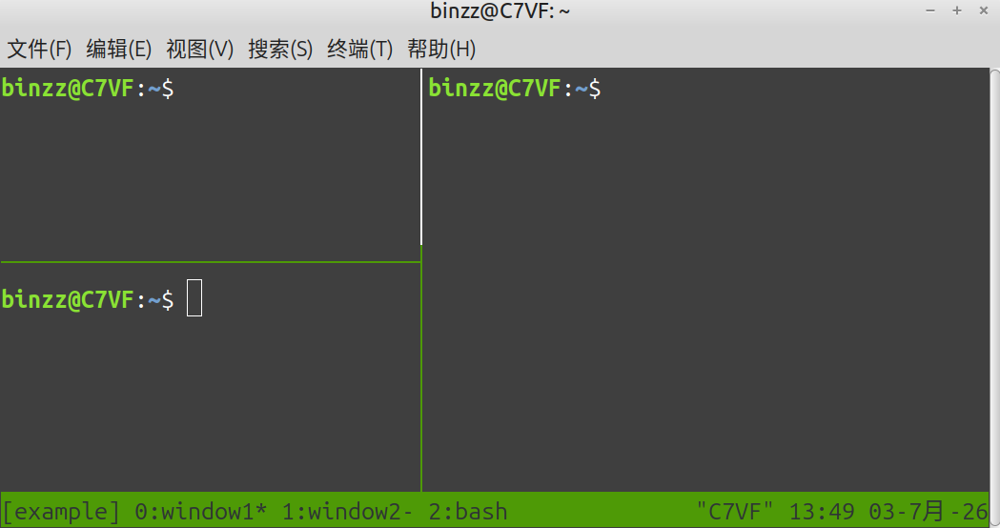

# {{ $frontmatter.title }}

**Description：** {{ $frontmatter.description }}。

| 适用系统 | 类型 | 标签 |
| --- | --- | --- |
| {{ $frontmatter.os.join(', ') }} | {{ $frontmatter.category.join(', ') }} | {{ $frontmatter.tags.join(', ') }}

---

[参考教程](https://www.runoob.com/linux/linux-comm-tmux.html)
```bash
# Debian 系的 Linux
sudo apt install tmux

# macOS
brew install tmux
```
大致是像这样，拆分窗口：


又远非拆分窗口（不然和 terminator 有什么区别呢），还可以保存会话记录呢！仅凭 tmux 自身的功能，保存会话的前提是不重启系统。不过安装[适当的插件](https://github.com/tmux-plugins/tmux-resurrect)，即使是重启系统，也可以恢复会话，这就是 tmux 的强大之处！

tmux 的三要素是，会话（Session）、窗口（Window）、面板（Panel）的概念。

从图中可以看出，当前会话叫做 example，有三个窗口分别叫 window1、window2、bash，目前第 0 个窗口 window1（右边有个星号），上一次所在窗口为 window2（右边有个减号）。window1被拆分成了图中的三块。

tmux 的每个指令都有一个前缀键，默认是 Ctrl + b（^b），然后再输入命令键。

## 进入 tmux 会话
```bash
# 查看所有会话
tmux ls
# 进入某一个会话
tmux attach -t <会话名>
# 进入最近的会话
tmux attach
# 创建新会话
tmux new-session -s <会话名>
# 如果这个会话只是临时性的，不需要保存，懒得起名字，则这样创建会话
tmux
```

## 在 tmux 会话中
```bash
^b c                 # 创建新窗口
^b %                 # 水平拆分面板
^b "                 # 垂直拆分面板

^b <arrow>           # 切换面板
^b n                 # 切换到下一个窗口
^b p                 # 切换到上一个窗口
^b <num>             # 切换到第<num>个窗口
^b s                 # 切换会话，会提示你选择

^b [ 上下箭头或 PageUp/PageDown   # 翻页，按q或Esc退出翻页模式

^b space             # 切换面板布局
^b z                 # 最大化/恢复当前面板

^b $ <新会话名>      # 重命名当前会话
^b , <新窗口名>      # 重命名当前窗口

^b x                 # 关闭当前面板
^b &                 # 关闭当前窗口
^b d                 # 退出当前会话，保存会话记录
^d                   # 退出当前会话，不保存会话记录（杀死会话）
```

