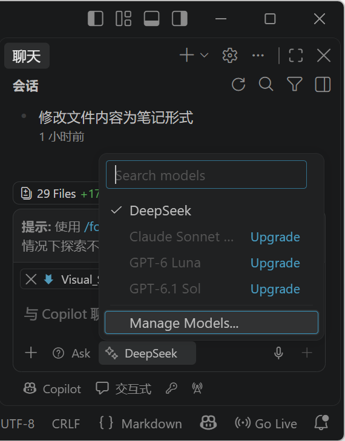

# {{ $frontmatter.title }}

[下载页](https://code.visualstudio.com/Download?_exp_download=d53503e735)

**Description：** {{ $frontmatter.description }}。

| 适用系统 | 类型 | 标签 |
| --- | --- | --- |
| {{ $frontmatter.os.join(', ') }} | {{ $frontmatter.category.join(', ') }} | {{ $frontmatter.tags.join(', ') }}

## AI 功能 Copilot
Ctrl + Alt + I 打开对话面板，Ctrl + I 打开内联聊天。

Copilot 作为国外模型，对国内模型不够友好，因为我们希望添加自己的 API，如下图所示，打开面板或内联聊天，选择模型->Manage Models，即可添加自定义模型，参考 https://zhuanlan.zhihu.com/p/2051439102130706200



## 插件推荐
### Costum Context Menu
解决 vscode 右键菜单选项过多的问题，可以自定义添加或删除特定选项。
1. `Ctrl+P`，输入
	```
	ext install EpicStuff.custom-context-menu
	```
	安装完成
2. 打开设置（`Ctrl+,`）打开settings.json（打开设置右上角 `{}`图标）
3. 添加配置 `custom‑contextmenu.selectors`，用正则匹配要隐藏的右键文字。配置示例：
	```json
	"custom-contextmenu.selectors": [
	  "^Markdown PDF:",
	  "MPE:",
	  "评审"
	]
	```
	保存之后，按 `Ctrl+Shift+P`，输入 `Enable Custom Contextmenu`，在弹出窗口的提示下重启 vscode，配置即可生效。
	>语法说明：`^Markdown PDF:` 代表所有以`Markdown PDF:`开头的一整组全部隐藏，不用一条一条写。
