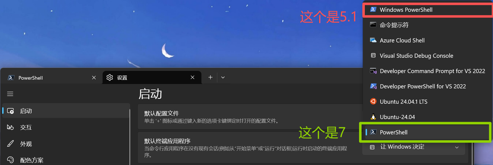
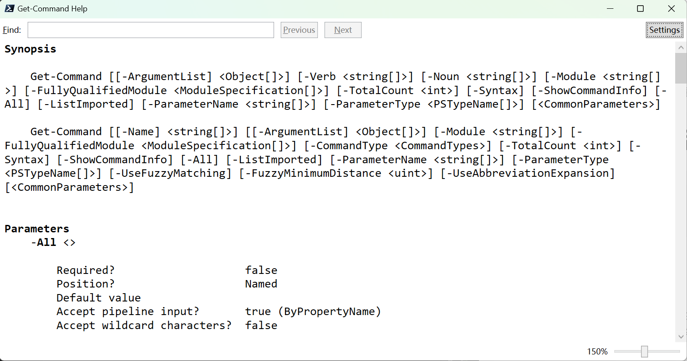

# {{ $frontmatter.title }}

本教程针对习惯了Linux命令行的Windows用户，希望通过本教程，能够快速上手PowerShell。我会常常以 Linux（以 Ubuntu 24.04.3 LTS 为例）的思维探究PowerShell，找出两者的联系和区别。因为……笔者就是这种人啊！

Shell，又叫壳程序，是一个命令行解释器，读取用户输入的命令并执行。例如，PowerShell 是 Windows 系统的 Shell，而 Bash 是 Linux 的 Shell。

写这个教程的动机是，在感受到 Bash 的便捷后，韩会会希望在 Windows 中也能找到这种感觉。固然有WSL（Windows Subsystem for Linux），无需学习新的Shell，但它毕竟只是是一个子系统，在使用上有一些限制。例如，我经常开发跨平台的应用，要写打包脚本或命令，但WSL不能生成`.exe`文件（Windows的可执行文件），也不能执行，不能满足我制作 Windows 版本的需求，学习 PowerShell 对于我来说就有必要了。

## 为什么使用 PowerShell 7

每个 Windows 系统都预装了 PowerShell 5.1，而最新的 PowerShell 版本是 PowerShell 7，官方也推荐使用 PowerShell 7，因其性能更佳、功能更加强大、且跨平台。

本教程基于 PowerShell 7 进行讲解，操作系统是预安装了 PowerShell 5.1 的 Windows 11。PowerSehll 5.1的命令和 PowerShell 7 大同小异。

但安装 PowerShell 7 后，不建议卸载 PowerShell 5.1，因为它是系统默认的 PowerShell 版本，卸载后可能会导致系统不稳定。这保持了Microsoft 的老传统，在推出 PowerShell 后，没有放弃 cmd；推出 PowerShell 7 后，也没有放弃 PowerShell 5.1。

### 获取当前 PowerShell 版本
在 PowerShell 中：
```powershell
Get-Host | Select-Object Version
```

## 安装 PowerShell 7
首先打开 PowerShell 5.1，按照[官方文档](https://learn.microsoft.com/zh-cn/powershell/scripting/install/install-powershell-on-windows?view=powershell-7.5#install-powershell-using-winget-recommended)安装 PowerShell 7。

退出终端后重启，发现打开的依然是 PowerShell 5.1。
打开终端的`设置 -> 启动 -> 默认配置文件`，设为 PowerShell，如下图所示。


## 初次体验 PowerShell
### 登入
Windows 并没有“真正等价于 Linux TTY 的官方纯文本控制台”，不能像 Linux 那样，按 `Ctrl+Alt+Fx` 切换到不同的 TTY，从 GUI 跳转到纯文本命令行界面。

能做到的最接近方案，恐怕是按 `Win+R`，输入以下三者的任意一种并回车了：
- `wt`（Windows Terminal）
- `powershell`（PowerShell 5.1）
- `pwsh`（PowerShell 7）

看，Windows 还是离不开GUI……这一点会在后文多次体现。

Linux TTY 只能显示 ASCII 字符，此时有必要将语系改为英文。但 Windows 没有上述情况，将语系改为英文，意义并不大。

### 语言 & 语系
PowerShell 没有 Bash 中 `LC_ALL` 这一整套 locale 变量，对应的是 **区域设置（culture）** 和 **代码页（code page）** 两套概念：

| 需求 | 命令 |
| -- | -- |
| 查看当前区域设置 | `Get-Culture`、`Get-UICulture` |
| 修改区域设置（影响当前用户） | `Set-Culture en-US` |
| 查看代码页 | `chcp` |
| 切换代码页为 UTF-8 | `chcp 65001` |
| 设置 PowerShell 输出编码为 UTF-8 | `[Console]::OutputEncoding = [System.Text.Encoding]::UTF8` |
| 设置管道输出编码 | `$OutputEncoding = [System.Text.Encoding]::UTF8` |

> `Set-Culture` 需要管理员权限；改 culture 通常需要重启会话才完全生效。

### 提示词蕴含的信息
看到的是这样，显示了版本信息、当前路径。
```powershell
PowerShell 7.5.4
PS C:\Users\binzz> 
# PS？是 PowerShell 的缩写啦！
# Windows 中，路径分隔符是反斜杠
```
不像 Bash 默认提示词那样，显示了用户名和主机名。如果要在 PowerShell 查看当前用户名、主机名、家目录，需要使用 `$env:USERNAME`、`$env:COMPUTERNAME`、`$env:USERPROFILE`。其中`$env:`代表这是一个环境变量，`USERNAME`、`COMPUTERNAME`、`USERPROFILE`是环境变量的名称。
```powershell
PS C:\Users\binzz> $env:USERNAME
binzz
PS C:\Users\binzz> $env:COMPUTERNAME
MSI713
PS C:\Users\binzz> $env:USERPROFILE
C:\Users\binzz
PS C:\Users\binzz>
```
有人说这不用`echo`的吗？可以，是等效的：
```powershell
PS C:\Users\binzz> echo $env:COMPUTERNAME
MSI713
PS C:\Users\binzz>
```
看，`echo`竟然也可以用在 PowerShell 中！这正是兼容了 Bash，照顾了习惯了 Linux 命令行的用户。

### 命令初探——Cmdlet 与 Alias
上面可以`echo`，再试试`pwd`、`ls`、`cd`、`clear`吧！
```powershell
PS C:\Users\binzz> pwd

Path
----
C:\Users\binzz

PS C:\Users\binzz> ls

    Directory: C:\Users\binzz

Mode                 LastWriteTime         Length Name
----                 -------------         ------ ----
d----            2025/1/8    21:31                .android
# ...节省版面，省略多行输出
-a---           2025/1/24     7:35            358 .rbql_init_source.js

PS C:\Users\binzz> cd ..
PS C:\Users> cd binzz   
PS C:\Users\binzz>
```
`clear`在 PowerShell 中，也能实现清屏。

那么 PowerShell 和 Bash 的命令是一样的咯！错啦，不然 PowerShell 还有什么意义呢？这么想会处处碰壁的！比如我想创建一个文件，想到 Bash 中的 `touch` 命令：
```powershell
PS C:\Users\binzz> touch hello.txt
touch: The term 'touch' is not recognized as a name of a cmdlet, function, script file, or executable program.
Check the spelling of the name, or if a path was included, verify that the path is correct and try again.
PS C:\Users\binzz>
```
正确做法是：
```powershell
PS C:\Users\binzz> New-Item hello.txt

    Directory: C:\Users\binzz

Mode                 LastWriteTime         Length Name
----                 -------------         ------ ----
-a---           2026/1/30    17:00              0 hello.txt

PS C:\Users\binzz> ls .\hello.txt

    Directory: C:\Users\binzz

Mode                 LastWriteTime         Length Name
----                 -------------         ------ ----
-a---           2026/1/30    17:00              0 hello.txt

PS C:\Users\binzz>
```
为啥写成`New-Item`这么繁？又如何找到其简写呢？这涉及到 PowerShell 的一个核心概念——Cmdlet。**Cmdlet（发音为 command-let）** 是 PowerShell 中最基本的命令单元，基于 .NET 类，运行后会返回一个或多个 .NET 对象，其名称为 `<动词>-<名词>` 的形式，例如 `Get-Process`、`Set-Item`，还有上述的`New-Item` 等。

可是我们刚才试过的`ls`、`pwd`、`ls`、`cd`、`clear`这些命令，都不是`<动词>-<名词>` 的形式，所以都不是 Cmdlet。事实上它们是一些**别名（Alias）**。例如，可以通过`Get-Command`查看命令的类型，包含了 Bash 中 `type` 和 `which` 的功能。如果是别名，则可能会显示，是谁（称为**Definiton**）的别名。至于为什么是“可能”，以及如果没有显示 Definition 时怎么办，查看[“日期&时间&日历”一节的示例部分](#date-time-calendar)。
```powershell
# ls 是 Get-ChildItem 这个Cmdlet 的别名
PS C:\Users\binzz> Get-Command ls

CommandType     Name                                               Version    Source
-----------     ----                                               -------    ------
Alias           ls -> Get-ChildItem # 幸运的，显示出 Definition 了。

# Get-ChildItem 是一个 Cmdlet，相当于 Linux 中的 built-in 类型
PS C:\Users\binzz> Get-Command Get-ChildItem

CommandType     Name                                               Version    Source
-----------     ----                                               -------    ------
Cmdlet          Get-ChildItem                                      7.0.0.0    Microsoft.PowerShell.Management

# pwsh 是一个 Application，相当于 Linux 中的 external 类型。
# 既然能找到它，说明它的路径在环境变量 PATH 中。
# 这一步体现了which的功能。
PS C:\Users\binzz> Get-Command pwsh

CommandType     Name                                               Version    Source
-----------     ----                                               -------    ------
Application     pwsh.exe                                           7.5.4.0    C:\Program Files\PowerShell\7\pwsh.exe

# 函数。
PS C:\Users\binzz> Get-Command mkdir

CommandType     Name                                               Version    Source
-----------     ----                                               -------    ------
Function        mkdir

# scoop 是一个外部脚本，相当于 Linux 中的 external 类型。
PS C:\Users\binzz> gcm scoop

CommandType     Name                                               Version    Source
-----------     ----                                               -------    ------
ExternalScript  scoop.ps1                                                     C:\Users\binzz\scoop\shims\scoop.ps1

PS C:\Users\binzz>
```
如果已知某个命令是一个别名，那么还可以通过以下方法查看其 Definition。其实这也不一定显示出 Definition，例外及解决方法见[“日期&时间&日历”一节的示例部分](#date-time-calendar)。
```powershell
PS C:\Users\binzz> Get-Alias ls

CommandType     Name                                               Version    Source
-----------     ----                                               -------    ------
Alias           ls -> Get-ChildItem

PS C:\Users\binzz> Get-Alias -Name ls

CommandType     Name                                               Version    Source
-----------     ----                                               -------    ------
Alias           ls -> Get-ChildItem

PS C:\Users\binzz>
```

有那么一点点 cmd 基础的朋友发现，`dir` 也可以实现 `ls` 的功能，`cls` 也可以实现 `clear` 的功能，说明 PowerShell 同时照顾了 Bash 和 cmd，一个 Cmdlet 可以有多个别名。事实上，PowerShell 可运行任何本机命令，不仅仅是 PowerShell。如何查看某个 Cmdlet 的所有别名呢？这样更有助于用户把 Cmdlet 输入简单啊！例如：
```powershell
PS C:\Users\binzz> Get-Alias -Definition Get-ChildItem

CommandType     Name                                               Version    Source
-----------     ----                                               -------    ------
Alias           dir -> Get-ChildItem    # 照顾了 cmd
Alias           gci -> Get-ChildItem    # PowerShell 自己起的
Alias           ls -> Get-ChildItem     # 照顾了 Bash

PS C:\Users\binzz>
```
还有一种将命令输入简单的途径是，**PowerShell 不区分大小写**。例如：
```powershell
# 对于 Cmdlet
PS C:\Users\binzz> Write-Output hello   # 原版
hello
PS C:\Users\binzz> write-output hello   # 写成小写
hello
PS C:\Users\binzz> wriTe-outPuT hello   # 随便写
hello

# 对于 Alias
PS C:\Users\binzz> echo hello           # 原版
hello
PS C:\Users\binzz> ECHO hello           # 写成大写
hello
PS C:\Users\binzz> EcHo hello           # 随便写
hello

# 对于 Application
# gcm 是 Get-Command 的别名
# Format-Table -AutoSize 实现列宽自适应
# Bash 管道符传的是字符串，PowerShell 管道符传的是 .NET 对象
PS C:\Users\binzz> gcm pWSh | Format-Table -AutoSize    # 原版是 pwsh

CommandType Name     Version Source
----------- ----     ------- ------
Application pwsh.exe 7.5.4.0 C:\Program Files\PowerShell\7\pwsh.exe

# 对于 Function
PS C:\Users\binzz> gcm MKDIR

CommandType     Name                                               Version    Source
-----------     ----                                               -------    ------
Function        mkdir

# 对于变量
PS C:\Users\binzz> echo $env:PATH
# ... 输出用英文分号分隔的一大堆路径
PS C:\Users\binzz> echo $ENV:path
# ... 输出用英文分号分隔的一大堆路径
PS C:\Users\binzz> echo $EnV:paTH
# ... 输出用英文分号分隔的一大堆路径
PS C:\Users\binzz>
```

### 提权
#### 持续提权
用管理员方式打开 PowerShell 即可。
#### 临时提权：sudo
参考 https://hydrotho.github.io/How-To-Use-Sudo-Command-In-PowerShell/

### 通配符与正则表达式
参考[官方文档](https://learn.microsoft.com/zh-cn/powershell/module/microsoft.powershell.core/about/about_wildcards?view=powershell-7.6)

### 输入输出重定向
参考[官方文档](https://learn.microsoft.com/zh-cn/powershell/module/microsoft.powershell.core/about/about_redirection?view=powershell-7.6)

### 脚本
是一个 .ps1 文件（1为数字而非字母）。与Linux Shell 脚本不同， PowerShell 脚本不会进入子Shell，会影响当前Shell的环境变量。

Windows出于安全考虑，默认禁止执行脚本，解决方案为：
```powershell
Set-ExecutionPolicy -Scope CurrentUser -ExecutionPolicy RemoteSigned
```

更多信息，参考[菜鸟教程](https://www.runoob.com/powershell/powershell-tutorial.html)。


### 常见小应用 
#### 日期 & 时间 & 日历 & 模块{#date-time-calendar}
Bash 中相关命令为 `date` 和 `cal`，PowerShell 中相关命令为 `Get-Date`，显示日历需要安装并导入第三方**模块（Module）**`PSCalendar`。

模块帮助用户组织和分隔 PowerShell 代码，使其更易于管理和重用。

1. 查找名为 "Pester" 的模块：
    ```powershell
    Find-Module -Name Pester
    ```
2. 安装名为 "Pester" 的模块：
    ```powershell
    Install-Module -Name Pester
    ```
    使用 `Get-InstalledModule` 查看已安装的模块。
3. 导入名为 "Pester" 的模块：
    ```powershell
    Import-Module -Name Pester
    ```
    只用导入这一次，下次登录时不需要导入就可以用这个模块。
4. 当前会话中移除名为 "Pester" 的模块：
    ```powershell
    Remove-Module -Name Pester
    ```
    这并不会删除模块文件。
5. 更新名为 "Pester" 的模块：
    ```powershell
    Update-Module -Name Pester
    ```
6. 将名为 "Pester" 的模块保存到目录 `.\modules`中：
    ```powershell
    Save-Module -Name Pester -Path .\modules
    ```
    起一个备份的作用。
7. 发布名为 "YourModule" 的模块：
    ```powershell
    Publish-Module -Name "YourModule" -NuGetApiKey "your-nuget-api-key"
    ```
    发布模块需要提供一些元数据，如模块名称、版本、描述和作者等。

例如这次安装并使用日历模块 `PSCalendar`
```powershell
# 直接安装，失败，提示未信任一个名为 PSGallery 的仓库（repository）。也由此得知，模块是从仓库中安装的。
PS C:\Users\binzz> Install-Module PSCalendar         

Untrusted repository
You are installing the modules from an untrusted repository. If you trust this repository, change its InstallationPolicy value by running the Set-PSRepository cmdlet. Are you sure you want to install the modules from 'PSGallery'?
[Y] Yes  [A] Yes to All  [N] No  [L] No to All  [S] Suspend  [?] Help (default is "N"): Y
Install-Package: The following commands are already available on this system:'Start-ThreadJob'. This module 'Microsoft.PowerShell.ThreadJob' may override the existing commands. If you still want to install this module 'Microsoft.PowerShell.ThreadJob', use -AllowClobber parameter. 

# 信任 PSGallery 仓库。       
PS C:\Users\binzz> Set-PSRepository -Name "PSGallery" -InstallationPolicy Trusted   

# 再次安装，又失败了，提示可能覆盖已有的命令。
PS C:\Users\binzz> Install-Module PSCalendar 
Install-Package: The following commands are already available on this system:'Start-ThreadJob'. This module 'Microsoft.PowerShell.ThreadJob' may override the existing commands. If you still want to install this module 'Microsoft.PowerShell.ThreadJob', use -AllowClobber parameter.      

# 加入提示里说的 -AllowClobber 参数，允许覆盖已有的命令。再次安装。成功！
PS C:\Users\binzz> Install-Module PSCalendar -AllowClobber         

# 导入模块
PS C:\Users\binzz> import-Module PSCalendar

# 查看模块 PSCalendar 提供的所有命令
PS C:\Users\binzz> Get-Command -Module PSCalendar                                      
                           
CommandType     Name                                               Version    Source  
-----------     ----                                               -------    ------  
Alias           Get-Calendar                                       2.11.1     PSCalendar 
Alias           Save-PSCalendarConfiguration                       2.11.1     PSCalendar
Alias           Show-Calendar                                      2.11.1     PSCalendar
Function        Export-PSCalendarConfiguration                     2.11.1     PSCalendar
Function        Get-MonthName                                      2.11.1     PSCalendar
Function        Get-NCalendar                                      2.11.1     PSCalendar
Function        Get-PSCalendar                                     2.11.1     PSCalendar
Function        Get-PSCalendarConfiguration                        2.11.1     PSCalendar 
Function        Set-PSCalendarConfiguration                        2.11.1     PSCalendar
Function        Show-GuiCalendar                                   2.11.1     PSCalendar
Function        Show-PSCalendar                                    2.11.1     PSCalendar
Function        Show-PSCalendarHelp                                2.11.1     PSCalendar

# 查看 2026 年 3 月的日历
PS C:\Users\binzz> Get-Calendar -Month 3 -Year 2026      # 唉，连阿拉伯数字都不能用的吗？偏要用中文。                             
Get-PSCalendar: Cannot validate argument on parameter 'Month'. You entered an invalid month. Valid choices are 一月,二月,三月,四月,五月,六月,七月,八月,九月,十月,十一月,十二月,     
# 还有上个月和下个月的……有点难看啊     
PS C:\Users\binzz> Get-Calendar -Month 三月 -Year 2026                                 
         
                  三月 2026                           
                            
  周一    周二    周三    周四    周五    周六    周日
  23    24    25    26    27    28     1
   2     3     4     5     6     7     8  
   9    10    11    12    13    14    15  
  16    17    18    19    20    21    22
  23    24    25    26    27    28    29
  30    31     1     2     3     4     5
# 加上 -MonthOnly 参数就好了！
PS C:\Users\binzz> Get-Calendar -Month 三月 -Year 2026 -MonthOnly

                  三月 2026

  周一    周二    周三    周四    周五    周六    周日
                                       1
   2     3     4     5     6     7     8
   9    10    11    12    13    14    15
  16    17    18    19    20    21    22
  23    24    25    26    27    28    29
  30    31
PS C:\Users\binzz>

# 看起来时 Cmdlet，实则是一个 Alias，但没有显示出 Definition。
PS C:\Users\binzz> Get-Command Get-Calendar

CommandType     Name                                               Version    Source
-----------     ----                                               -------    ------
Alias           Get-Calendar                                       2.11.1     pscalendar

PS C:\Users\binzz> Get-Alias Get-Calendar

CommandType     Name                                               Version    Source
-----------     ----                                               -------    ------
Alias           Get-Calendar                                       2.11.1     pscalendar

# 强行显示 Definition
PS C:\Users\binzz> Get-Command Get-Calendar | Select-Object Name, Definition

Name         Definition
----         ----------
Get-Calendar Get-PSCalendar

# Get-Command Get-Calendar 返回一个 .NET 对象，类似于 pandas 的 DataFrame。
# Select-Object 提取出 .NET 对象的 Name 和 Definition 属性的值，好比 pandas 中从 DataFrame 提取列。

PS C:\Users\binzz>             
```

#### 计算器 & 类与对象的概念
Bash中使用 `bc`，而PowerShell 本身就是计算器，详情见[官方文档](https://learn.microsoft.com/zh-cn/powershell/module/microsoft.powershell.core/about/about_arithmetic_operators?view=powershell-7.5)。不只是支持数哟！

里面提到了[数组](https://learn.microsoft.com/zh-cn/powershell/module/microsoft.powershell.core/about/about_arrays?view=powershell-7.5)、[哈希表](https://learn.microsoft.com/zh-cn/powershell/module/microsoft.powershell.core/about/about_hash_tables?view=powershell-7.5)（类似于 Python 中的字典）、[类](https://learn.microsoft.com/zh-cn/powershell/module/microsoft.powershell.core/about/about_classes_constructors?view=powershell-7.5)等一些重要概念。个人感觉和 Python 类似。

#### 文本编辑器 & 软件管理器Scoop & 注册表初探
Windows 官方不提供 CLI 编辑器。如果想用vim，不建议使用`winget vim.vim`，理由：
- 会弹出 GUI 安装向导，而不是在命令行安装。
- 安装完后，在命令行输入 `vim` 会显示 “vim 不是内部或外部命令，也不是可运行的程序或批处理文件”。

Scoop 则解决了上述问题，有着 Linux 中 Debian 阵营发行版的 APT 一样丝滑的软件管理体验。

安装方法如下：
##### 用 Scoop 安装
1. 安装 Scoop：
    ```powershell
    # 允许运行远程脚本
    Set-ExecutionPolicy RemoteSigned -Scope CurrentUser 
    irm get.scoop.sh | iex  # 安装 scoop
    scoop install vim
    ```
2. 用 Scoop 安装 Vim：
    ```powershell
    PS C:\Users\binzz> scoop install vim
    Installing 'vim' (9.1.1825) [64bit] from 'main' bucket
    Loading gvim_9.1.1825_x64.zip from cache
    Checking hash of gvim_9.1.1825_x64.zip ... ok.
    Extracting gvim_9.1.1825_x64.zip ... done.
    Linking ~\scoop\apps\vim\current => ~\scoop\apps\vim\9.1.1825
    Creating shim for 'vim'.    # shim 是个可执行文件，指向实际的 vim.exe。
    Creating shim for 'vi'.
    Creating shim for 'ex'.
    Creating shim for 'view'.
    Creating shim for 'rvim'.
    Creating shim for 'rview'.
    Creating shim for 'vimdiff'.
    Creating shim for 'gvim'.
    Making C:\Users\binzz\scoop\shims\gvim.exe a GUI binary.    # 告诉 Windows 这是个 GUI 程序，不要在命令行运行。
    Creating shim for 'gview'.
    Making C:\Users\binzz\scoop\shims\gview.exe a GUI binary.
    Creating shim for 'evim'.
    Making C:\Users\binzz\scoop\shims\evim.exe a GUI binary.
    Creating shim for 'eview'.
    Making C:\Users\binzz\scoop\shims\eview.exe a GUI binary.
    Creating shim for 'rgvim'.
    Making C:\Users\binzz\scoop\shims\rgvim.exe a GUI binary.
    Creating shim for 'rgview'.
    Making C:\Users\binzz\scoop\shims\rgview.exe a GUI binary.
    Creating shim for 'gvimdiff'.
    Making C:\Users\binzz\scoop\shims\gvimdiff.exe a GUI binary.
    Creating shim for 'xxd'.
    Creating shortcut for gVim (gvim.exe)
    Running post_install script...done.
    'vim' (9.1.1825) was installed successfully!
    Notes
    -----
    Add gVim as a context menu option by running: "C:\Users\binzz\scoop\apps\vim\current\install-context.reg"   # 注册表？是个啥玩意？了解清楚了再判断是否执行！
    'vim' suggests installing 'vimtutor'.    # 是个 Vim 教程（Tutorial），我试过，连路径都解析不对，根本跑不了。
    PS C:\Users\binzz> gcm vim

    CommandType     Name                                               Version    Source
    -----------     ----                                               -------    ------
    Application     vim.exe                                            0.0.0.0    C:\Users\binzz\scoop\shims\vim.exe

    PS C:\Users\binzz>
    ```
    注册表是一个有层级关系的数据库。在这里，执行注册表文件后，如果右击一个文本文件，会有一个“用 Vim 打开”的选项。
    ```powershell
    # `install-context.reg`的内容如下：
    PS C:\Users\binzz> cat C:\Users\binzz\scoop\apps\vim\current\install-context.reg
    Windows Registry Editor Version 5.00

    [HKEY_CURRENT_USER\Software\Classes\*\shell\Edit with &Vim]
    @="Edit with &Vim"
    "Icon"="C:\\Users\\binzz\\scoop\\apps\\vim\\current\\gVim.exe"
    [HKEY_CURRENT_USER\Software\Classes\*\shell\Edit with &Vim\command]
    @="\"C:\\Users\\binzz\\scoop\\apps\\vim\\current\\gVim.exe\" \"%1\""

    # 写一个“反向”的注册表文件。注意多了一个减号。执行它，就可以撤销执行 install-context.reg 的效果。
    PS C:\Users\binzz> cat uninstall-context.reg
    Windows Registry Editor Version 5.00

    [-HKEY_CURRENT_USER\Software\Classes\*\shell\Edit with &Vim]
    PS C:\Users\binzz>
    ```
##### 直接通过 WSL
如果你在 WSL 中安装了 Vim，直接在 PowerShell 中输入 `wsl vim` 即可打开 Vim。事实上，通过 `wsl <command>` 可以在 PowerShell 中运行 WSL 中的命令。

## 按键绑定（Key Bindings）
这与 [`Get-PSReadLineOption`](https://learn.microsoft.com/zh-cn/powershell/module/psreadline/get-psreadlineoption?view=powershell-7.5) 的 [EditMode](https://learn.microsoft.com/zh-cn/powershell/module/psreadline/set-psreadlineoption?view=powershell-7.5#-editmode) 属性有关。
```powershell
PS C:\Users\binzz> Get-PSReadLineOption | Select-Object -Property EditMode

EditMode
--------
 Windows    # 还可以是 Emacs 或 Vi

# 获取当前具体的快捷键
PS C:\Users\binzz> Get-PSReadLineKeyHandler
# ... 太多了，自己看，这里省略
# 想改成 Emacs（PowerShell for Linux 的默认值），需要执行：
# Set-PSReadLineOption -EditMode Emacs
```

## 启动时配置
Bash 通过 `~/.bashrc`、`~/.bash_profile` 等实现。PowerShell 对应的是 **配置文件（profile）**，路径由内置变量 `$PROFILE` 提供：

| 变量 | 作用域 | 示例路径（PowerShell 7） |
| -- | -- | -- |
| `$PROFILE.AllUsersAllHosts` | 所有用户、所有宿主 | `C:\Program Files\PowerShell\7\profile.ps1` |
| `$PROFILE.AllUsersCurrentHost` | 所有用户、当前宿主 | `C:\Program Files\PowerShell\7\Microsoft.PowerShell_profile.ps1` |
| `$PROFILE.CurrentUserAllHosts` | 当前用户、所有宿主 | `~/Documents/PowerShell/profile.ps1` |
| `$PROFILE.CurrentUserCurrentHost` | 当前用户、当前宿主 | `~/Documents/PowerShell/Microsoft.PowerShell_profile.ps1` |

- 等价于 `~/.bashrc` 的是 `$PROFILE.CurrentUserCurrentHost`（最常用，即 `$PROFILE` 本身）。
- 注意 Windows PowerShell 5.1 的路径是 `~/Documents/WindowsPowerShell/...`，与 PowerShell 7 的 `~/Documents/PowerShell/...` 不同。
- 编辑方法：`code $PROFILE`（VS Code）或 `notepad $PROFILE`（GUI）。文件不存在时手动创建即可，PowerShell 每次启动都会加载它。


## 获取帮助
我想实现某个功能，不知道用什么命令怎么办？不知道某个命令怎么用，怎么办？在 Linux 中，是用`man`和`info`解决的。PowerShell也可以使用 `man`实现这一点，它是函数`help`的别称。
```powershell
PS C:\Users\binzz> help ls

NAME
    Get-ChildItem

SYNTAX
    Get-ChildItem [[-Path] <string[]>] [[-Filter] <string>] [-Include <string[]>] [-Exclude <str
    ing[]>] [-Recurse] [-Depth <uint>] [-Force] [-Name] [-Attributes {None | ReadOnly | Hidden |
     System | Directory | Archive | Device | Normal | Temporary | SparseFile | ReparsePoint | Co
    mpressed | Offline | NotContentIndexed | Encrypted | IntegrityStream | NoScrubData}] [-Follo
    wSymlink] [-Directory] [-File] [-Hidden] [-ReadOnly] [-System] [<CommonParameters>]
# ... 省略多行内容

PARAMETERS
    -Attributes <FlagsExpression[FileAttributes]>

        Required?                    false  # 是必选项吗？
        Position?                    Named  
        Accept pipeline input?       false  # 支持管道输入吗？
        Parameter set name           (All)  
        Aliases                      None   
        Dynamic?                     true
        Accept wildcard characters?  false   # 支持通配符吗？
# ... 省略多行内容
-- More  --
```
按空格键翻到下一页，按 `q` 退出。这种窗口的快捷键功能远远没有Linux 中的`man`和`info`强大，只支持这两种按键，不过，在支持GUI的情况下，可以附上`-Online`参数，打开浏览器查看帮助。
```powershell
help ls -Online

# 其他参数
help ls -Full       # 最详细的信息
help ls -Example    # 只查看示例
```

不过使用`Get-Help`，也输出了同样的内容。
```powershell
PS C:\Users\binzz> Get-Command help

CommandType     Name                                               Version    Source
-----------     ----                                               -------    ------
Function        help

PS C:\Users\binzz> help help

NAME
    Get-Help
# ...省略多行内容
```
上面的现象有点奇怪，前者说`help`是一个函数而非别名，但为什么后者的Name是Get-Help呢？并且`help`与`Get-Help`的输出相同。这涉及到`help`这个函数本身的定义。
```powershell
# 方法 1：直接查看函数内容
Get-Content Function:\help

# 方法 2：使用 Get-Command 的 Definition 属性
(Get-Command help).Definition

# 方法 3：查看函数详细信息
Get-Item Function:\help | Format-List *

# 方法 4：更清晰的查看
$function:help
```
输出来一长串，看来`help`并不仅仅是`Get-Help`这么简单，相较于`Get-Help`的区别是以类似于 Linux man page 的方式展示帮助信息，参数和选项与`Get-Help`的相同。

建议用`Get-Help`，并添加`-Online`参数，查看在线中文帮助，更容易看懂。或使用`-ShowWindow`参数，会弹出一个窗口，效果也很不错，如下图所示。

关于更多信息，查看[官方文档](https://learn.microsoft.com/zh-cn/powershell/scripting/learn/ps101/02-help-system?view=powershell-7.5)。我已经看爽了！！！

## 登出 & 关机 & 重启
```powershell
exit                 # 登出
shutdown -s -t 0     # 关机
shutdown -r -t 0     # 重启
``` 

## 总结
- Windows 系统不能完全摆脱对 GUI 的依赖。
- PowerShell 的命令以 Cmdlet 为基本单位，以别名的方式兼容了 Bash 和 cmd，且不区分大小写，有助于简化命令的输入。还有 Application、函数、脚本等。
- PowerShell 将万物视为 .NET 对象而非数据流，拥有丰富的属性和方法，类似于面向对象编程（OOP，Object-Oriented Programming）。
