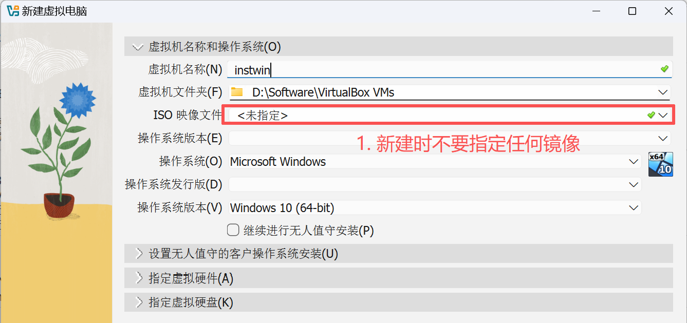
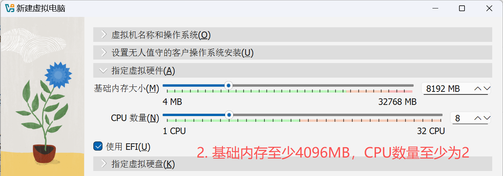
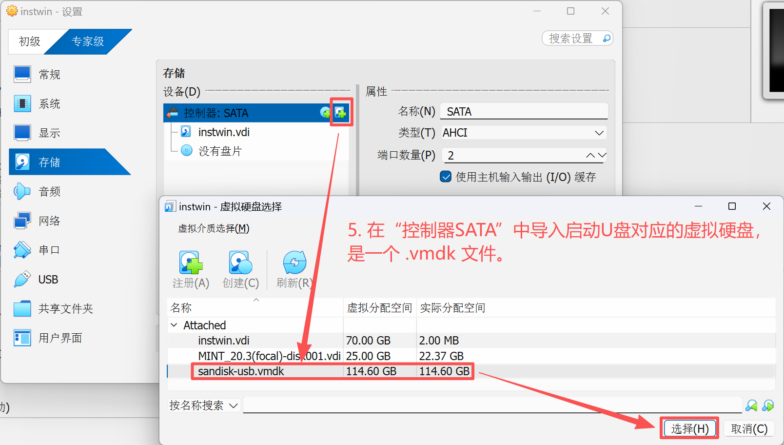
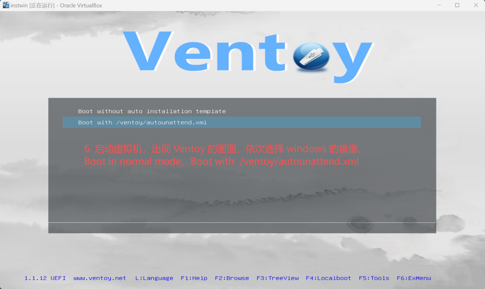
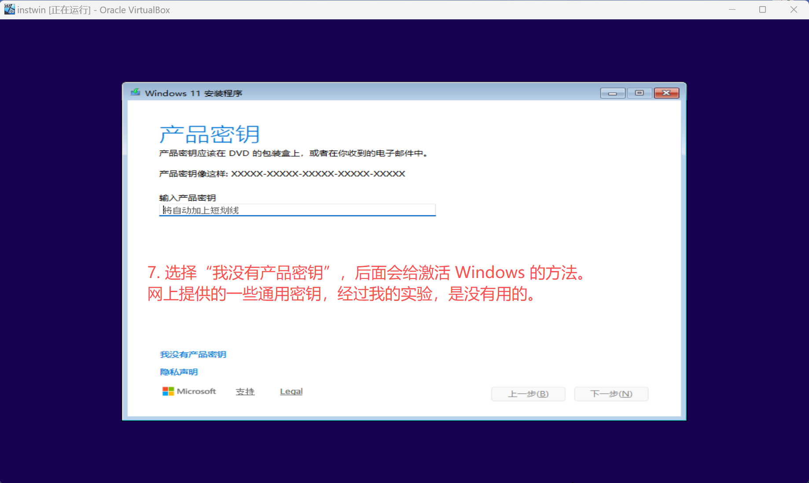
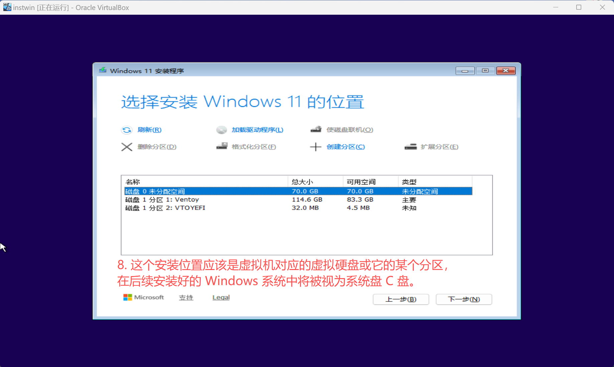
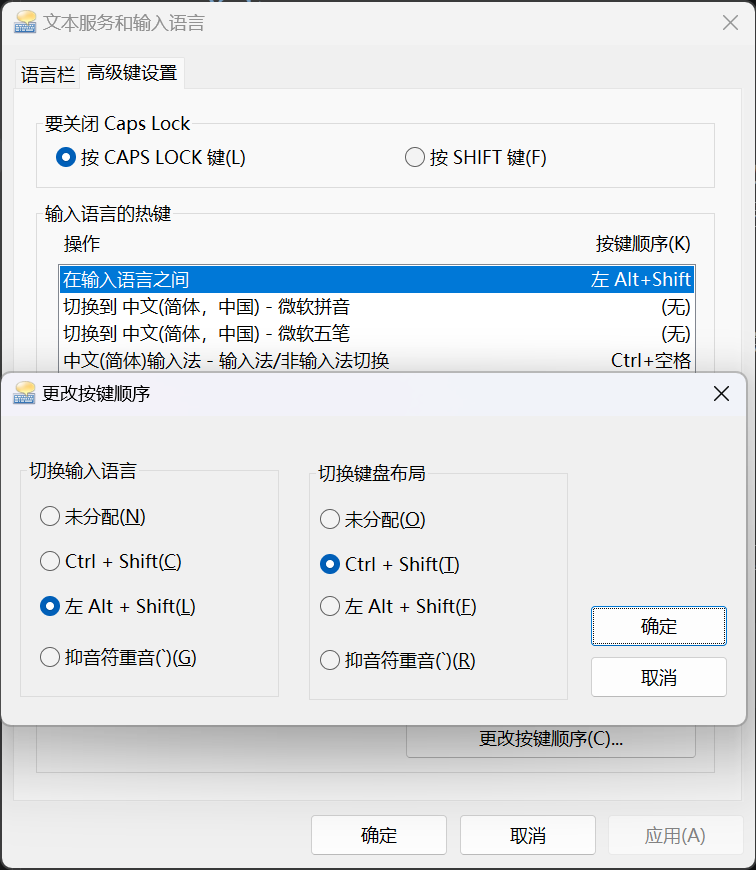

# {{ $frontmatter.title }}

Windows 是目前世界上最流行的操作系统，每个碰过电脑的人，不管对计算机有多少了解，都一定用过 Windows。然而，大部分只是用它进行消遣娱乐、日常工作，并不能说是“会用Windows”。

“会用Windows”指了解 Windows 的设计哲学与运作方式，在碰到问题时不至于束手无策，对相关信息有自己的判断，会使用 PowerShell 等工具提高工作效率。

## 虚拟机安装 Windows11
学会了之后，就知道怎么在实体机上安装了。安装其他版本的 Windows 也是类似的方法。

WinXP 的其中一个[产品密钥](https://cloud.tencent.com/developer/article/2442418)：M6TF9-8XQ2M-YQK9F-7TBB2-XGG88
Win11 Pro 的其中一个产品密钥：VK7JG-NPHTM-C97JM-9MPGT-3V66T

### 1. 改造安装程序
改造的目的是跳过安装过程中 Microsoft 在线账户的登录、检查更新。前者强求用户注册 MS 账户；后者占用了安装的大量时间。

准备一个用 [Ventoy](https://ventoy.net/cn/download.html) 制作好的启动U盘，在 U 盘根目录下创建一个文件夹 `ventoy`，在 `ventoy` 中生成两份文件 `ventoy.json` 和 `autounattend.xml`（**应答文件**，Answer file）。

前者内容如下：
```json
{
    "auto_install": [
        {
            "image": "/path/to/win11.iso",
            "template": "/ventoy/autounattend.xml"
        }
    ]
}
```

这样用 U 盘启动安装镜像 `win11.iso` 时，会加载应答文件，自动回答安装过程中需要用户输入的问题、注入一些配置、改造安装行为，避免 MS 的一些强制行为。


后者在 [Schneegans Windows Answer File Generator](https://schneegans.de/windows/unattend-generator/) 中生成，重要的是要勾选如下选项：
- Bypass Windows 11 requirements check (TPM, Secure Boot, etc.)
- Disable Fast Startup
- Allow execution of PowerShell script files
- Prevent device encryption

### 2. 关闭 VBS（基于虚拟化的安全性）
这样做是为了加快安装速度。在宿主机上 Win + R，运行 `msinfo32`，查看“基于虚拟化的安全性”是否为“未启用”。否则，按以下方法关闭：
以管理员身份打开 PowerShell，输入
```powershell
bcdedit /set hypervisorlaunchtype off
```
然后重启宿主机。

> 使用 [WSL](https://learn.microsoft.com/zh-cn/windows/wsl/) 时，需要开启 VBS，将以上命令的最后一个参数改为 `on` 即可。这是一对是否开启 VBS 的矛盾。

### 3. 新增并配置虚拟机







制作 .vmdk 文件的方法，参照 [韩会会的 Oracle VirtualBox 教程中“启动U盘”一节](../SoftShare/Oracle_VirtualBox.md#启动u盘)。

### 4. 进入 Win11 安装程序






### 5. 激活 Win11
采用 [Microsoft Activation Scripts](https://github.com/massgravel/Microsoft-Activation-Scripts) 提供的方法进行激活。


### 6. 重要设置
#### 开机时跳过磁盘校验
运行 `regedit`（**注册表编辑器**），找到
```
HKEY_LOCAL_MACHINE\SYSTEM\CurrentControlSet\Control\Session Manager`
```
一项，清空 `BootExecute` 的值。这个值默认为 `autocheck autochk *`，表示开机时会自动检查磁盘。如果安装了其他系统如各种 Linux Distribution，磁盘检查不会通过，导致无法使用 Windows，这就是需要跳过磁盘校验的原因。 

#### 停止更新服务
关机时会在后台进行更新服务，严重拖慢关机过程，长达数分钟。

#### 关机速度优化（重要！）
如果关机需要数分钟，可以通过以下注册表优化将关机时间缩短到 30 秒以内。

以**管理员身份**打开 CMD 或 PowerShell，依次执行：

```cmd
:: 1. 缩短服务停止等待时间（默认5秒，改为2秒）
reg add "HKLM\SYSTEM\CurrentControlSet\Control" /v WaitToKillServiceTimeout /t REG_SZ /d "2000" /f

:: 2. 缩短无响应应用等待时间（改为1秒）
reg add "HKCU\Control Panel\Desktop" /v HungAppTimeout /t REG_SZ /d "1000" /f
reg add "HKCU\Control Panel\Desktop" /v WaitToKillAppTimeout /t REG_SZ /d "1000" /f

:: 3. 自动结束无响应的程序
reg add "HKCU\Control Panel\Desktop" /v AutoEndTasks /t REG_SZ /d "1" /f

:: 4. 禁用关机时清理页面文件（如果开启的话会非常慢）
reg add "HKLM\SYSTEM\CurrentControlSet\Control\Session Manager\Memory Management" /v ClearPageFileAtShutdown /t REG_DWORD /d 0 /f

:: 5. 禁用快速启动（Fast Startup）—— 加快关机但稍减慢开机
reg add "HKLM\SYSTEM\CurrentControlSet\Control\Session Manager\Power" /v HiberbootEnabled /t REG_DWORD /d 0 /f

:: 6. 禁用详细状态消息
reg add "HKLM\SOFTWARE\Microsoft\Windows\CurrentVersion\Policies\System" /v VerboseStatus /t REG_DWORD /d 0 /f
```

执行完毕后重启电脑生效。如果关机仍然很慢，还可以：
- 在任务管理器的"启动"选项卡中禁用不必要的启动项
- 在 `services.msc` 中禁用不需要的后台服务
- 检查硬盘健康状态，机械硬盘考虑升级 SSD


#### 中文输入法
1. 在 “设置 -> 时间和语言 -> 语言和区域 -> 首选语言中” 点击 “添加语言”，添加中文。
2. 进入 “设置 -> 时间和语言 -> 输入 -> 高级键盘设置 -> 语言栏选项 -> 高级键设置”，每选择“操作”的一项，都有对应的“切换按键顺序”。

    

#### 打开虚拟磁盘服务
虚拟机才需要进行本设置，解决了虚拟机中无法使用 Windows 自带的磁盘管理的问题。

**症状**：打开磁盘管理（diskmgmt.msc）时，一直卡在"正在连接虚拟磁盘服务..."，无法显示磁盘信息。

**原因**：Virtual Disk Service (VDS) 服务未启动或异常。

**快速修复**：
Win + R，运行 `services.msc`，找到 Virtual Disk 并启动。如果设为自动启动，则该服务每次开机时都会自动开启。

**如果启动失败或仍然卡死**，以管理员身份打开 CMD，执行以下命令修复：

```cmd
:: 停止 VDS 服务
net stop vds 2>nul

:: 重新注册 VDS 组件
cd /d C:\Windows\System32
regsvr32 /s vds_ps.dll
regsvr32 /s vdsutil.dll

:: 修复 VDS 注册表配置
sc config vds start= demand
reg add "HKLM\SYSTEM\CurrentControlSet\Services\vds" /v Start /t REG_DWORD /d 3 /f

:: 重启依赖的 RPC 服务
net stop RpcSs /y
net start RpcSs

:: 启动 VDS 服务
net start vds

:: 验证状态
sc query vds
```

如果以上方法都无效，尝试运行系统文件检查：
```cmd
sfc /scannow
DISM /Online /Cleanup-Image /RestoreHealth
```
