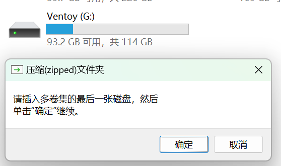
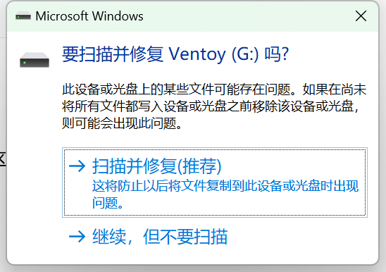

# {{ $frontmatter.title }}

## U盘的插入

如果插入U盘后出现上面的弹窗，则需要删除U盘里损坏的压缩包文件。


如果是这个弹窗，选择“扫描并修复（推荐）”，不会对U盘里的数据造成影响，敬请放心。

## 将一个毫不相关的目录认成家目录
在 Git Bash 中：
```bash
binzz@MSI713 MINGW64 ~
$ pwd
/d/Software/Cadence OrCAD 1.72/Cadence/SPB_Data 
```
在 Claude Code CLI 中出现橙色警告：
```
Native installation exists but D:\Software\Cadence OrCAD 1.72\Cadence\SPB_Data\.local\bin is not in your PATH.
```
Cadence OrCAD 1.72 是一个电路设计软件，为什么上述错误中会提示这个与 Git Bash 和 Claude Code CLI 毫不相关的路径呢？

这是因为OrCAD/Cadence安装时新增了一个用户级环境变量 `HOME`，指向它自己的 SPB_Data 目录，于是所有读取`HOME`的工具全部被带偏：
- Git‑Bash：`~`、`$HOME` 指向SPB_Data；
- git 全局配置 `.gitconfig` 就跑到 `D:\Software\Cadence OrCAD 1.72\Cadence\SPB_Data\.gitconfig`；
- ssh‑gen生成密钥也会跑到这个目录；
- VirtualBox、MSYS2同样会中招，是硬件工程师非常有名的一个冲突坑。

**✅修复步骤**
1. Windows搜索「编辑账户的环境变量」打开环境变量面板
2. 在上方【用户变量里面，找到变量名叫 `HOME`
3. 直接删除这一条HOME变量
4. 全部确定保存，关闭所有被带偏的工具，重新打开
5. 在新终端验证：
    ```bash
    echo $HOME
    ```
    现在就会变成 `/c/Users/binzz`（你的Windows用户目录）

> 💡补充说明：删掉HOME之后OrCAD本身还可以正常工作；Cadence自己内部还有`SPB_DATA`变量，它不需要系统HOME变量也能跑PCB。
> 少数老版本Cadence安装包会反复重新写回HOME，如果修复完又出现，就是安装包自动复原了。

**附带小提醒**
- PowerShell / CMD 不受这个HOME变量影响；只有MSYS/Git‑Bash、Cygwin、VirtualBox这类类Unix工具会读取Windows的HOME环境变量。
- WSL不受Windows这个HOME环境变量影响；WSL有自己Linux内部的`$HOME`，二者互相隔离。
