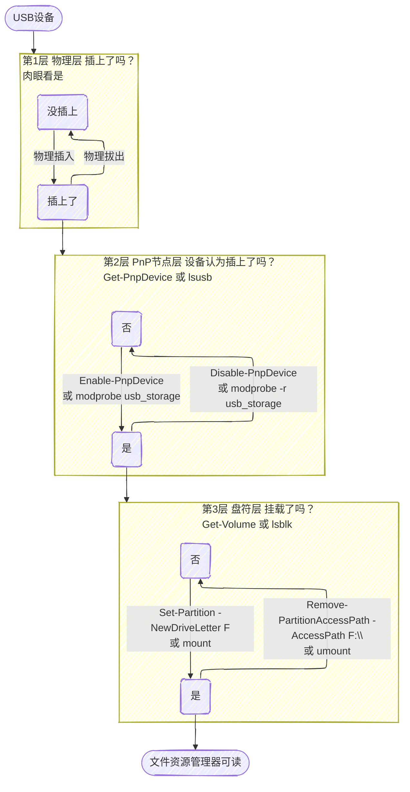

# {{ $frontmatter.title }}

## Windows 磁盘管理概念



## diskpart 工具管理磁盘分区

```powershell
PS C:\Users\binzz> diskpart

Microsoft DiskPart 版本 10.0.22621.1

Copyright (C) Microsoft Corporation.
在计算机上: MSI713

DISKPART> list volume

  卷 ###      LTR  标签         FS     类型        大小     状态       信息
  ----------  ---  -----------  -----  ----------  -------  ---------  --------
  卷     0     C                NTFS   磁盘分区         220 GB  正常         启动
  卷     1     D                NTFS   磁盘分区         323 GB  正常         页面文件
  卷     2     E                NTFS   磁盘分区         241 GB  正常
  卷     3                      FAT32  磁盘分区         100 MB  正常         系统
  卷     4                      NTFS   磁盘分区         812 MB  正常         已隐藏
  卷     5         HuihuiHan    exFAT  可移动          114 GB  正常
  卷     6     H   VTOYEFI      FAT    可移动           32 MB  正常

DISKPART> select volume 5

卷 5 是所选卷。

DISKPART>  assign letter=G

DiskPart 成功地分配了驱动器号或装载点。

DISKPART>
```


## 插入 U 盘的 GUI 行为（自动播放）
windows系统中，每次插入U盘都会弹出一个文件资源管理器窗口，但我习惯在同一个窗口的不同标签页使用文件资源管理器，不想在插入U盘时弹出新窗口，更希望是以系统通知的形式提醒我。实现方法为：
1. `Win + I` 打开设置
2. Win11：蓝牙和其他设备 → 自动播放
   Win10：设备 → 自动播放
3. 打开「在所有媒体和设备上使用自动播放」总开关
4. 可移动驱动器下拉框，选择：**每次都询问我**
5. 点右下角**保存**
    - **每次都询问我**：插入U盘后，在「此电脑」增加盘符，弹出右下角Toast通知，不会自动打开新窗口，你点通知才会打开U盘的文件资源管理器。
    - **不执行任何操作**：插入U盘完全没有通知，仅默默在「此电脑」增加盘符。
6. 点右下角**保存**。
