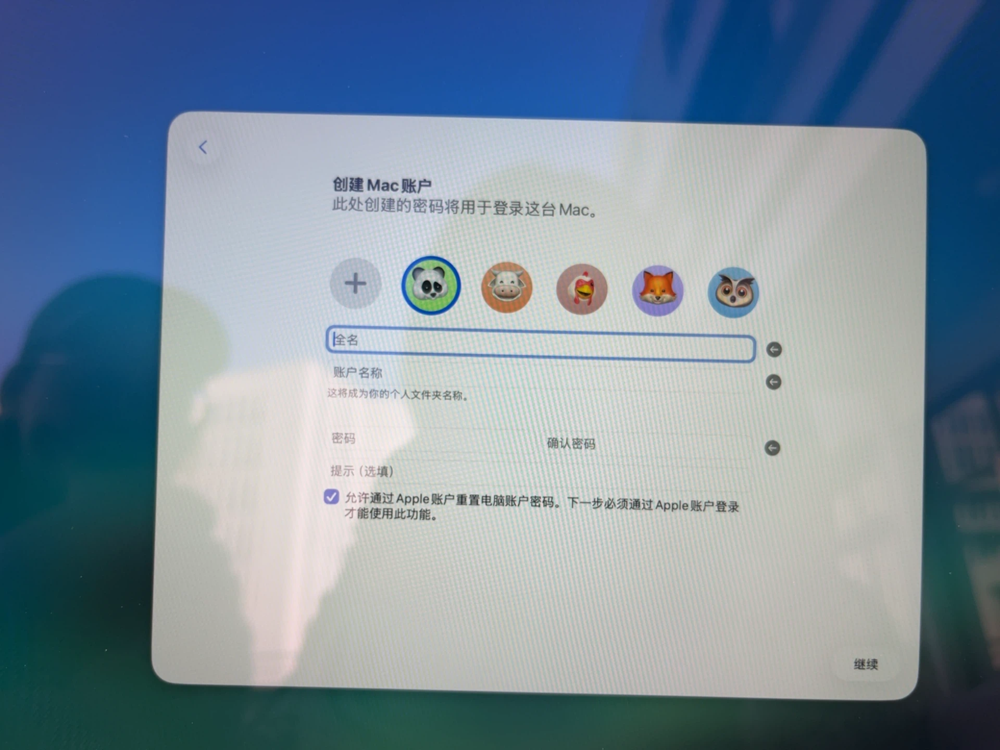
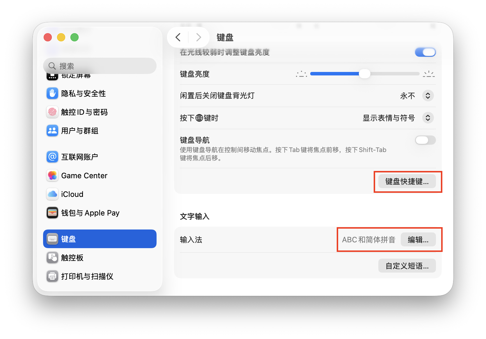

# {{ $frontmatter.title }}

韩会会使用的是 MacBook Air M5，macOS Tahoe 26.6 系统。

## macOS 的性质
和 Linux 一样，都是类 Unix 系统，但设计哲学与 Linux 截然不同。

Linux主张“一切皆文件”，可以脱离GUI而作为CLI独立运行，最典型的应用是服务器。Linux默认用户懂得自己在做什么，用户要为自己的行为负责。Linux 极度信任root，有了root 权限，什么都能干，所以 Linux 的配置工作比带有商业性质的 macOS 和 Windows 简单得多。

理论上 Unix 的亲儿子完全可以脱离GUI而作为CLI独立运行，但 macOS 比较“叛逆”，并没有做到这一点，因为 macOS 认为用户是小白，设计哲学是轻量快捷、小白友好且安全。即使你是 root，也不是什么都能做，摆脱不了苹果官方的一些限制。

## 激活新买的苹果电脑
一定要确保网络环境良好，不然会出现什么都点不了的情况。事实上对于任何苹果设备的系统安装、更新，都是如此。当然，万一什么都点不了了，可以长按电源键（也就是右上角那个键，也叫 Touch ID 键）重启，在确保有稳定网络可连接的条件下，重新开始激活流程。

不要用公司、机场、学校的网络，因为它们很不稳定！！！

### 本地账户注册以及 iCloud 登录

激活时，到了上图这一步，学过 Linux 的我有些发怵，这个账户看起来与 Linux 的用户等效，不过是真的吗？还是什么线上账号呢？问了AI，才终于确认，是与 Linux 用户等效的本地账户，决定你在命令行中的用户名。至于 iCloud 账号的登录，会在后续过程中进行。

## 键盘 & 键位
苹果的快捷键往往用符号显示，希望大家熟记。
| 苹果键盘上的 | 键位上相当于 Windows 的 | 功能上相当于 Windows 上的 |
| -- | -- | -- |
| ⌘ command | Alt | Ctrl |
| ⌥ option | Win | Alt |
| ⌃ control | 左Ctrl的右半部分 | 没有对应关系，是少数快捷键的修饰键 |
| 🌐 fn | 左Ctrl的左半部分 | 没有对应关系，是少数快捷键的修饰键 |
| ⇧ shift | Shift | Shift |
| ⎋ escape | Esc | Esc |
| ␣ space | 空格 | 空格 |

macOS 的快捷键大全：https://support.apple.com/zh-cn/102650

国行苹果电脑的 CapsLock **显示为 中/英，按一下就能实现中英输入法的切换**，比 ⌃␣ 更方便按，我有时按 中/英，有时按 ⌃␣，怎么顺手怎么来。如果**要实现大写锁定，请长按 CapsLock**，再按一下，回到原来的中英输入法。这是默认设置，想改变这种行为，请在 “设置 -> 键盘”下的 “键盘快捷键 -> 输入法” 和 “文字输入 -> ABC 和简体拼音”右边的“编辑”按钮进行设置，如下图所示。个人认为默认最好用，因为如果取消了 CapsLock 换中英，在中文输入下按 CapsLock 时，输入的却是小写字母，在英文输入下按 CapsLock，输入的才是大写字母，并没有完全复刻在 Windows 上的习惯。

| Windows键盘上有的而苹果键盘没有的 | 在苹果键盘上怎么实现等效 |
| -- | -- |
| Delete | ⌫，既叫 backspace 也叫 del。如果要实现删除文件到回收站，使用 ⌘⌫ |
| Home | 🌐◀︎ |
| End | 🌐► |
| Page Up | 🌐▲| 
| Page Down | 🌐▼ |

## 电源计划及电池管理
苹果电脑不太需要关机，不用时直接合盖即可。很多天不用时才关机。

合上盖子默认是睡眠（安全睡眠 safe sleep），不是Windows那样完全断电的休眠，会耗电，但是正常情况下很低。
1. **刚合盖：浅睡眠**
内存持续通电保存你的所有窗口、程序状态，CPU降频，屏幕关闭。唤醒极快，开盖秒恢复。内存供电本身就会持续耗电。
2. **连续睡眠约3小时后 → 自动进入待机（Standby）**
系统会把内存快照写入SSD，之后切断内存供电，耗电压到极低，这一步才更接近Windows的休眠。
